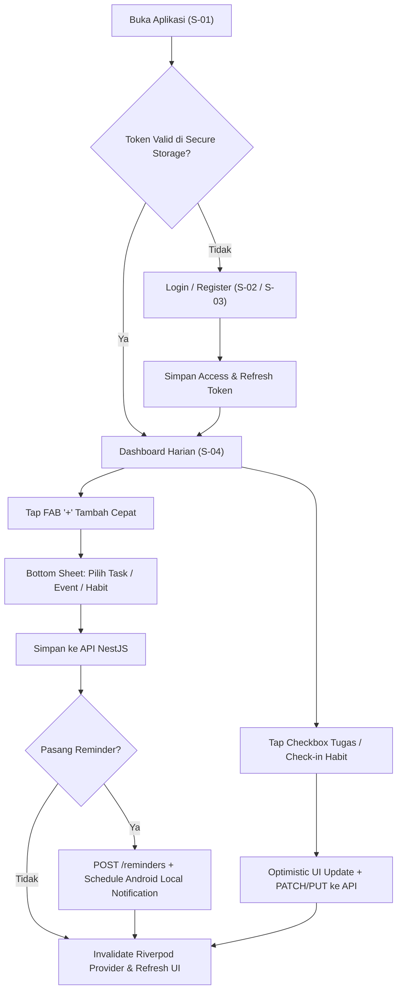

# LifeOS — Product Design Brief & UI/UX Specification

**Dokumen:** `02-design-brief.md`  
**Produk:** LifeOS (Personal Productivity App · Android)  
**Framework UI:** Flutter (Material 3 Custom Theme)  
**Target Platform:** Android (API 26+ · Mobile & Tablet Responsive)  

---

## 1. Design Principles (3 Aturan Wajib UI LifeOS)

1. **Scannable in 3 Seconds (Kemudahan Pindai Instan):**
   Mahasiswa yang membuka aplikasi di sela pergantian kelas harus langsung menangkap *berapa tugas tersisa*, *jadwal terdekat*, dan *habit yang belum dicentang* dalam 3 detik pertama. Gunakan kartu terstruktur (*card-based layout*), angka metrik tegas, dan *badge* warna semantik—bukan paragraf panjang.
2. **One-Tap Daily Execution (Eksekusi Harian Satu Sentuhan):**
   Aksi berfrekuensi tinggi (mencentang tugas selesai, *check-in* kebiasaan harian, dan membuka *bottom sheet* tambah tugas) wajib dapat dieksekusi dalam **1 sentuhan** langsung dari kartu item tanpa harus masuk ke halaman detail terlebih dahulu.
3. **Function Over Decoration (Fungsi di Atas Dekorasi):**
   Setiap piksel harus memiliki fungsi informasi. Tidak boleh ada ilustrasi dekoratif besar yang mendorong daftar tugas ke bawah *fold* layar, tidak ada animasi transisi lebih dari `250ms`, dan filter harus ringkas (*horizontal chip bar*) agar tidak memakan ruang daftar utama.

---

## 2. Visual Direction

### Mood & Karakter Visual
- **Tone:** Fokus, tenang, terstruktur, akademik-modern (*Calm Structured Productivity*).
- **Karakter:** Menggabungkan ketegasan tipografi ala **Linear / Notion Calendar** dengan kehangatan kartu modular ala **Things 3 / TickTick Modern UI**.
- **Alasan Pemilihan Warna Indigo (`#4F46E5`):** Indigo memadukan stabilitas warna biru dengan energi fokus warna ungu. Berbeda dari biru korporat standar yang terasa kaku seperti aplikasi kantor/HR, Indigo memberikan kesan modern dan segar bagi mahasiswa serta memiliki rasio kontras yang sangat baik pada mode terang maupun gelap.

### Referensi Visual Utama
1. **Dashboard & Card Hierarchy:** *TaskSphere Smart Task Management* — sapaan personal di atas, kartu ringkasan progres, diikuti seksi agenda dan tugas harian dengan *checkbox* interaktif.
2. **Task List & Bottom Sheet Form:** *AI Task Management Mobile UI* — indikator prioritas dan tenggat waktu yang langsung terlihat jelas pada tiap baris kartu tugas tanpa memadati layar.
3. **Habit Tracker Grid & Streak:** *Habits App by Andrew Larin* — kartu per kebiasaan dengan indikator progres 7 hari mingguan dan tombol *check-in* satu sentuhan di sisi kanan kartu.

### Apa yang Wajib Dihindari (Anti-Patterns)
- **JANGAN** gunakan efek *glassmorphism* berlebihan atau *gradient* warna-warni mencolok yang mengaburkan keterbacaan teks.
- **JANGAN** sembunyikan aksi tambah tugas di balik menu *hamburger* atau *speed-dial FAB* berlapis.
- **JANGAN** gunakan warna merah menyala (`#DC2626`) untuk elemen selain status *Overdue/Error*, prioritas *HIGH*, atau aksi *Delete*.
- **JANGAN** membuat form pembuatan tugas menjadi halaman penuh berisi 10 *field*; gunakan *Modal Bottom Sheet* yang fokus.

---

## 3. Design Tokens

### 3.1 Palet Warna (Light & Dark Mode)

| Token Role | Light Mode (Default) | Dark Mode | Penggunaan |
| :--- | :--- | :--- | :--- |
| `color.primary` | `#4F46E5` (Indigo 600) | `#6366F1` (Indigo 500) | CTA utama, FAB, aktif tab, checkbox tercentang, progres utama |
| `color.primaryContainer` | `#EEF2FF` (Indigo 50) | `#1E1B4B` (Indigo 950) | Background chip aktif, highlight tanggal terpilih, badge kegiatan |
| `color.background` | `#F8FAFC` (Slate 50) | `#0B0F19` (Slate 950) | Latar belakang utama scaffold aplikasi |
| `color.surface` | `#FFFFFF` (White) | `#111827` (Gray 900) | Permukaan kartu (*Card*), *Bottom Sheet*, *Navigation Bar* |
| `color.surfaceVariant` | `#F1F5F9` (Slate 100) | `#1E293B` (Slate 800) | Input field background, chip tidak aktif, track progress bar |
| `color.border` | `#E2E8F0` (Slate 200) | `#334155` (Slate 700) | Garis tepi kartu 1px (menggantikan bayangan tebal) |
| `color.textPrimary` | `#0F172A` (Slate 900) | `#F8FAFC` (Slate 50) | Judul halaman, judul tugas/habit/event, angka metrik |
| `color.textSecondary` | `#64748B` (Slate 500) | `#94A3B8` (Slate 400) | Subtitle, tanggal, lokasi kegiatan, label kosong |
| `color.success` | `#16A34A` (Green 600) | `#22C55E` (Green 500) | Tugas `DONE`, habit check-in selesai, indikator tepat waktu |
| `color.warning` | `#D97706` (Amber 600) | `#F59E0B` (Amber 500) | Prioritas `MEDIUM`, tugas mendekati deadline (< 24 jam) |
| `color.error` | `#DC2626` (Red 600) | `#EF4444` (Red 500) | Tugas `OVERDUE`, prioritas `HIGH`, validasi error, tombol hapus |

### 3.2 Tipografi (Material 3 Type Scale)
- **Font Family Utama:** `Plus Jakarta Sans` (untuk *Heading* & *Title* — geometris, modern, sangat jelas untuk angka metrik) dikombinasikan dengan `Inter` atau `Roboto` (untuk *Body* & *Label* — keterbacaan tinggi pada ukuran kecil di layar Android).

| Token | Ukuran / Line Height | Weight | Penggunaan |
| :--- | :--- | :--- | :--- |
| `display.metric` | `28sp` / `34sp` | `700 (Bold)` | Angka utama pada kartu ringkasan Dashboard & Statistik |
| `headline.screen` | `22sp` / `28sp` | `700 (Bold)` | Judul halaman utama di AppBar / Header sapaan |
| `title.section` | `18sp` / `24sp` | `600 (SemiBold)` | Judul seksi (misal: "Agenda Hari Ini", "Kebiasaan Aktif") |
| `title.card` | `16sp` / `22sp` | `600 (SemiBold)` | Judul Tugas, nama Habit, judul Kegiatan Kalender |
| `body.default` | `14sp` / `20sp` | `400 (Regular)` | Deskripsi tugas, lokasi kegiatan, teks isi umum |
| `label.badge` | `12sp` / `16sp` | `600 (SemiBold)` | Badge prioritas (`HIGH`), chip filter, jam agenda, indikator streak |
| `caption.meta` | `11sp` / `14sp` | `500 (Medium)` | Timestamp kecil, label hari pada grid mingguan (`S S R K J S M`) |

### 3.3 Spacing, Radius, & Elevation
- **Skala Spacing Dasar:** `4px` (xs), `8px` (sm), `12px` (md), `16px` (lg - padding standar layar & kartu), `24px` (xl - jarak antar seksi utama), `32px` (2xl).
- **Border Radius:**
  - Kartu utama (`Card`): `16px`
  - Bottom Sheet (sudut atas): `24px`
  - Tombol (`Button`) & Input Field: `12px`
  - Badge / Status Pill: `8px` (atau `999px` untuk *filter chip*)
- **Shadow & Border:**
  - Gunakan pendekatan **Flat-Bordered Card**: `1px solid #E2E8F0` pada mode terang dengan bayangan sangat halus (`0 1px 3px rgba(15, 23, 42, 0.04)`). Hindari `elevation` Material bawaan yang membuat kartu tampak keabu-abuan.

---

## 4. Screen Inventory

Aplikasi menggunakan **Bottom Navigation Bar 5 Tab** untuk navigasi primer agar seluruh fitur inti MVP dapat dijangkau dengan ibu jari tanpa *drawer* samping.

| ID | Nama Screen | Route Path | Tujuan Utama |
| :--- | :--- | :--- | :--- |
| **S-01** | **Splash & Auth Gate** | `/splash` | Memeriksa ketersediaan token di secure storage dan mengarahkan ke Login atau Dashboard |
| **S-02** | **Login Screen** | `/auth/login` | Masuk ke akun dengan email & password |
| **S-03** | **Register Screen** | `/auth/register` | Membuat akun baru beserta deteksi otomatis zona waktu perangkat (`Asia/Jakarta`) |
| **S-04** | **Dashboard Screen (Tab 1)** | `/dashboard` | Pusat kendali harian: ringkasan metrik, tugas mendesak, agenda hari ini, dan habit check-in |
| **S-05** | **Tasks Screen (Tab 2)** | `/tasks` | Daftar lengkap seluruh tugas dengan pencarian, filter chip, pengelompokan, dan CRUD |
| **S-06** | **Task Detail & Reminder Sheet** | `/tasks/:id` | Menampilkan detail lengkap tugas, ubah status/prioritas, dan atur waktu Reminder lokal |
| **S-07** | **Calendar Screen (Tab 3)** | `/calendar` | Kalender bulanan/mingguan terpadu yang menampilkan `CalendarEvent` dan `Task` ber-deadline |
| **S-08** | **Habits Screen (Tab 4)** | `/habits` | Daftar kebiasaan, *check-in* harian, progres mingguan 7 hari, dan *streak* |
| **S-09** | **Habit Detail & History Screen** | `/habits/:id` | Riwayat kalender kepatuhan habit, statistik konsistensi, dan edit hari aktif (`activeDays`) |
| **S-10** | **Statistics & Profile Screen (Tab 5)** | `/statistics` | Laporan penyelesaian tugas, tugas terlambat, grafik tren mingguan, daftar reminder aktif, & tombol Logout |

---

## 5. User Flows (Journey Utama)

### Journey 1: Pagi Hari — Cek Prioritas & Eksekusi Cepat (< 15 Detik)
1. Pengguna membuka aplikasi $\rightarrow$ langsung masuk ke **Dashboard (S-04)**.
2. Pengguna melihat kartu ringkasan: *"3 Tugas Tertunda · 1 Mendekati Deadline · 2 Agenda Hari Ini"*.
3. Pengguna menyelesaikan kebiasaan pagi (*"Membaca 20 menit"*) dengan **1 tap** pada tombol *check-in* di seksi *Habit Hari Ini* $\rightarrow$ indikator berubah hijau (`#16A34A`) dan *streak* bertambah `+1`.
4. Pengguna mencentang tugas yang baru diselesaikan langsung dari daftar *Tugas Hari Ini* di Dashboard.

### Journey 2: Mencatat Tugas Baru + Memasang Pengingat Lokal
1. Dari layar Dashboard (S-04) atau Tasks (S-05), pengguna menekan tombol **FAB `+`**.
2. Muncul **Task Form Bottom Sheet**: pengguna mengetik judul *"Kumpul Laporan Praktikum Jarkom"*, memilih chip prioritas `HIGH`, memilih tanggal & jam tenggat `Besok, 12:00`, dan mengaktifkan toggle **"Ingatkan Saya"** (`10:00 Pagi`).
3. Pengguna menekan **"Simpan Tugas"**:
   - Aplikasi memanggil `POST /api/v1/tasks`.
   - Aplikasi memanggil `POST /api/v1/reminders` dengan `taskId` baru tersebut.
   - Service notifikasi Flutter menjadwalkan alarm lokal Android pada pukul `10:00` esok hari.
4. Bottom sheet tertutup, daftar tugas dan indikator kalender otomatis terbarui.

### Journey 3: Mengecek Beban Mingguan di Kalender Terpadu
1. Pengguna membuka tab **Kalender (S-07)**.
2. Kalender menampilkan titik indikator pada tanggal yang memiliki kegiatan (`Indigo`) dan tenggat tugas (`Amber`/`Red`).
3. Pengguna mengetuk hari Kamis $\rightarrow$ daftar di bawah kalender menampilkan urutan kronologis gabungan:
   - `08:00 - 10:00` [EVENT] Kuliah Sistem Operasi (Gedung B R.204)
   - `12:00` [TASK - HIGH] Tenggat Laporan Praktikum Jarkom
   - `15:30 - 17:00` [EVENT] Rapat Panitia Kampus

---

## 6. Layout per Screen Kunci

### S-04: Dashboard Screen
- **Top Header:** Sapaan dinamis (*"Selamat pagi, Rayhan"*), tanggal lokal hari ini (*"Minggu, 18 Okt 2026"*), dan ikon lonceng pintasan menuju daftar Reminder terjadwal.
- **Section 1 — Summary Bento Grid (2x2 atau 1 Kartu Lebar + 2 Kartu Kecil):**
  - Kartu Utama (Indigo surface): Progress bar penyelesaian hari ini (`60% Selesai · 3 dari 5 tugas`).
  - Kartu Mini Kiri: Tugas Terlambat (`1 Overdue` — warna teks merah jika $>0$).
  - Kartu Mini Kanan: Target Habit Hari Ini (`2/3 Selesai`).
- **Section 2 — Agenda Hari Ini (`upcomingEvents`):** Daftar horizontal atau kartu ringkas kegiatan hari ini dengan waktu mulai–selesai dan lokasi.
- **Section 3 — Kebiasaan Hari Ini:** Daftar kartu habit yang terjadwal aktif hari ini beserta tombol *check-in* cepat.
- **Section 4 — Tugas Prioritas & Mendekati Deadline:** Maksimal 5 tugas teratas dengan checkbox langsung.
- **Primary Action:** Floating Action Button (`#4F46E5`) di kanan bawah untuk tambah cepat.

### S-05: Tasks Management Screen
- **Top Bar:** Judul *"Tugas"* + bilah pencarian (*Search Bar* dengan *debounce* `400ms`).
- **Filter Strip (1 Baris Horizontal Scroll):**
  - Status Chips: `Semua`, `Belum Selesai (TODO)`, `Dikerjakan (IN_PROGRESS)`, `Selesai (DONE)`.
  - Priority Filter Icon/Chip: `HIGH`, `MEDIUM`, `LOW`.
- **Main Content:** `ListView.separated` berisi `TaskCard` dengan jarak `12px`. Mendukung *pull-to-refresh* dan *infinite scroll pagination*.
- **Primary Action:** FAB `+ Tambah Tugas` yang membuka `TaskFormBottomSheet`.

### S-07: Calendar Screen
- **Top Bar:** Nama Bulan & Tahun (`Oktober 2026`), tombol `"Hari Ini"`, dan *segmented toggle* (`Bulan` | `Minggu`).
- **Calendar Header Widget:** Grid kalender interaktif dengan penanda titik (*dot markers*) di bawah angka tanggal.
- **Selected Date Timeline:** Daftar gabungan `CalendarEvent` dan `Task` pada tanggal terpilih yang diurutkan berdasarkan jam (`startsAt` / `dueAt`).
- **Primary Action:** FAB `+ Kegiatan` untuk membuka `EventFormBottomSheet`.

### S-08: Habit Tracker Screen
- **Top Bar:** Judul *"Kebiasaan"* + tombol `+ Habit Baru`.
- **Main Content:** Daftar `HabitCard`. Setiap kartu menampilkan:
  - Baris atas: Nama kebiasaan, badge *Current Streak* (`🔥 5 hari`), dan tombol bulat *Check-in Hari Ini* (`48x48dp` area sentuh).
  - Baris bawah: **Weekly Mini-Grid** (7 lingkaran hari `Sen` s/d `Min` untuk minggu berjalan; hijau = selesai, abu gelap = hari aktif belum selesai, titik pudar = hari libur/tidak aktif).

### S-10: Statistics & Profile Screen
- **Top Bar:** Judul *"Statistik & Profil"* + pemilih rentang waktu (`7 Hari Terakhir` | `30 Hari Terakhir`).
- **Section 1 — KPI Overview Cards:**
  - *Completion Rate* (`78%`), *Total Tugas Selesai* (`18`), *Tugas Terlambat* (`2`), *Konsistensi Habit* (`85%`).
- **Section 2 — Weekly Trend Chart:** Grafik batang vertikal 7 hari (`Sen`–`Min`) yang menampilkan jumlah tugas selesai dan habit tercapai per hari.
- **Section 3 — Pengaturan Akun & Reminder:** Info email, zona waktu (`Asia/Jakarta`), status izin notifikasi Android, dan tombol **Logout**.

---

## 7. Component Library (Komponen Reusable)

| Komponen | Lokasi Direktori | Variants | States |
| :--- | :--- | :--- | :--- |
| **`TaskCard`** | `core/widgets/task_card.dart` | `compact` (Dashboard), `detailed` (Task List) | `todo`, `inProgress`, `done` (strikethrough + opacity `0.65`), `overdue` (red due badge) |
| **`PriorityBadge`** | `core/widgets/priority_badge.dart` | `low` (Slate), `medium` (Amber), `high` (Red) | Default static pill |
| **`HabitCard`** | `features/habits/presentation/widgets/` | `dashboardCompact`, `fullWeeklyGrid` | `uncheckedToday`, `checkedToday` (Green check animation), `inactiveDay` |
| **`AgendaItemTile`** | `features/calendar/presentation/widgets/` | `eventItem` (Indigo accent bar + jam mulai-selesai), `taskDeadlineItem` (Amber/Red bar + checkbox) | `upcoming`, `ongoing`, `past/completed` |
| **`MetricSummaryCard`** | `core/widgets/metric_summary_card.dart` | `heroPrimary` (Indigo), `neutralSurface`, `alertOverdue` | `loading` (shimmer), `loaded` |
| **`ReminderBannerTile`** | `features/reminders/presentation/widgets/` | `taskReminder`, `eventReminder` | `scheduled`, `sent`, `cancelled`, `permissionMissing` |
| **`AppEmptyState`** | `core/widgets/app_empty_state.dart` | `emptyTasks`, `emptyHabits`, `emptyAgenda`, `emptySearch` | Menampilkan ikon garis minimalis, judul singkat, subteks, dan tombol CTA opsional |

---

## 8. Screen States (Empty, Loading, Error, Success, Offline)

Setiap layar wajib menangani 5 state berikut secara eksplisit melalui `AsyncValue` Riverpod:

| State | Perilaku Visual di LifeOS |
| :--- | :--- |
| **1. Loading** | Gunakan **Skeleton Shimmer Cards** yang meniru bentuk kartu asli (3 baris kartu di daftar tugas/dashboard). **Dilarang** menampilkan layar putih kosong dengan `CircularProgressIndicator` di tengah layar saat *initial load* atau *refresh*. |
| **2. Empty** | Menampilkan komponen `AppEmptyState` yang kontekstual. Contoh di Tasks: *"Belum ada tugas hari ini. Tambahkan tugas kuliah atau targetmu sekarang"* + tombol `Buat Tugas Pertama`. |
| **3. Error** | Jika API mengembalikan `500` atau gagal terhubung dan tidak ada *cache*, tampilkan kartu error dengan pesan manusiawi (bukan *raw exception*), kode status, dan tombol **`Coba Lagi`**. Pada validasi form (`400`), tampilkan pesan error merah langsung di bawah field terkait berdasarkan `details` dari API. |
| **4. Success** | Transisi instan (*optimistic update* untuk *checkbox* dan *habit check-in*) disertai *HapticFeedback.lightImpact()* dan `SnackBar` ringkas berdurasi `2 detik` untuk aksi pembuatan/penghapusan data. |
| **5. Offline** | Menampilkan `OfflineBanner` ramping di bagian atas layar (`"Mode Offline · Menampilkan data terakhir"`). Data yang sudah di-*cache* secara lokal tetap dapat dibaca dan dinavigasi. Aksi tulis yang membutuhkan server menampilkan informasi jelas bahwa koneksi internet diperlukan. |

---

## 9. Responsive Behaviour (Android Mobile & Tablet)

- **Compact Screens ( Lebar `< 600dp` — Mayoritas Smartphone Android):**
  - Layout satu kolom (`Single Column Scroll`).
  - Navigasi utama menggunakan `NavigationBar` (Material 3 Bottom Navigation) dengan 5 destinasi.
  - Padding horizontal layar: `16dp`.
- **Medium & Expanded Screens (Lebar `>= 600dp` — Tablet Android & Foldable Terbuka):**
  - Navigasi utama otomatis beralih dari `NavigationBar` bawah ke `NavigationRail` di sisi kiri layar.
  - Halaman **Dashboard** dan **Statistics** menggunakan grid 2 kolom (`Row` / `SliverGrid`) sehingga kartu ringkasan dan daftar agenda tampil berdampingan.
  - Halaman **Calendar** menggunakan tampilan *Master-Detail* (Kalender bulanan di kolom kiri `50%`, daftar agenda harian di kolom kanan `50%`).
  - Lebar maksimum form dan daftar dibatasi pada `720dp` di tengah container agar baris teks tidak terlalu panjang.

---

## 10. Accessibility (Standar Aksesibilitas Android)

1. **Rasio Kontras Warna (WCAG AA Minimum 4.5:1):**
   - Teks utama `#0F172A` di atas `#FFFFFF` memiliki rasio kontras **19.3:1** (AAA).
   - Teks sekunder `#64748B` di atas `#FFFFFF` memiliki rasio kontras **4.76:1** (Lulus AA).
   - Warna tombol utama `#4F46E5` dengan teks putih `#FFFFFF` memiliki rasio kontras **6.29:1** (Lulus AA).
2. **Touch Target Minimum (`48x48dp`):**
   - Seluruh elemen interaktif kecil—termasuk *checkbox* tugas, tombol *check-in* habit, dan ikon hapus pengingat—wajib memiliki *hit test area* minimal `48x48dp` meskipun ukuran ikon visualnya `20dp` atau `24dp`.
3. **Indikator Non-Warna:**
   - Status dan prioritas tidak pernah mengandalkan warna saja: prioritas selalu menyertakan teks label (`HIGH`, `MEDIUM`, `LOW`) dan tugas terlambat menyertakan ikon jam peringatan + label `"Terlambat"`.
4. **Screen Reader (TalkBack) & Focus Order:**
   - Urutan fokus pembaca layar mengalir secara logis dari kiri-atas ke kanan-bawah: Header $\rightarrow$ Ringkasan Metrik $\rightarrow$ Filter $\rightarrow$ Daftar Kartu $\rightarrow$ FAB.
   - Tombol *checkbox* dan *habit check-in* wajib dibungkus `Semantics(label: 'Tandai tugas [Judul] selesai', checked: isDone)`.
5. **Dynamic Font Scaling:**
   - Seluruh kartu menggunakan tinggi adaptif (tidak mematok `height: 80` secara *hardcode*) sehingga layout tidak pecah (*RenderFlex overflow*) ketika pengguna mengatur ukuran font Android ke `130%`.
