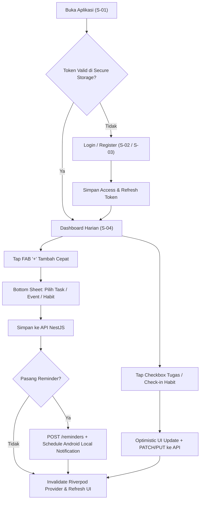

# LifeOS — Product Design Brief & UI/UX Specification

**Dokumen:** `02-design-brief.md`  
**Produk:** LifeOS (Personal Productivity App · Android)  
**Framework UI:** Flutter (Material 3 Custom Theme)  
**Target Platform:** Android (API 26+ · Mobile & Tablet Responsive)  
**Acuan Desain:** [`design/THEME_PROMPT.md`](file:///c:/Users/Rey/Documents/Projects/lifeOS/design/THEME_PROMPT.md) & [`planning/DESIGN.md`](file:///c:/Users/Rey/Documents/Projects/lifeOS/planning/DESIGN.md)

---

## 1. Design Principles (3 Aturan Wajib UI LifeOS)

1. **Scannable in 3 Seconds (Kemudahan Pindai Instan):**
   Mahasiswa yang membuka aplikasi di sela pergantian kelas harus langsung menangkap *berapa tugas tersisa*, *jadwal terdekat*, dan *habit yang belum dicentang* dalam 3 detik pertama. Gunakan kartu terstruktur (*card-based layout*), angka metrik tegas, dan *badge* warna semantik—bukan paragraf panjang.
2. **One-Tap Daily Execution (Eksekusi Harian Satu Sentuhan):**
   Aksi berfrekuensi tinggi (mencentang tugas selesai, *check-in* kebiasaan harian, dan membuka *bottom sheet* tambah tugas) wajib dapat dieksekusi dalam **1 sentuhan** langsung dari kartu item tanpa harus masuk ke halaman detail terlebih dahulu.
3. **Function Over Decoration & Zero AI Slop (Fungsi di Atas Dekorasi):**
   Setiap piksel harus memiliki fungsi penyampaian informasi. Tidak boleh ada ilustrasi dekoratif 3D plastik besar yang mendorong konten ke bawah *fold*, tidak ada efek *glassmorphism* atau gradien mencolok, tidak ada animasi transisi lebih dari `200ms`, dan filter harus ringkas (*horizontal chip bar*). Kedalaman dibentuk secara taktil melalui garis tepi presisi `1px solid #DBE2EF` dan bayangan ambient alami bertingkat rendah.

---

## 2. Visual Direction

### Mood & Karakter Visual
- **Tone:** Solid, Flat, Tactile, High-Contrast & Utilitarian (*Calm Structured Enterprise Productivity*).
- **Karakter:** Menggabungkan ketegasan tipografi modern ala **Linear / Notion Calendar** dengan kehangatan kartu modular ala **Things 3** dan filosofi fungsionalisme Dieter Rams.
- **Alasan Pemilihan Palet Color Hunt (*Nordic Slate & Deep Ocean Navy*):**  
  Palet `#F9F7F7` (Canvas), `#DBE2EF` (Soft Slate Border), `#3F72AF` (Ocean Blue Primary), `#112D4E` (Deep Navy Headline/Panel), dan `#526D82` (Slate Navy Secondary) dipilih karena:
  1. Sangat ramah mata di layar mobile Android: kanvas off-white `#F9F7F7` mereduksi silau dibanding *pure white* `#FFFFFF`.
  2. Rasio kontras tinggi yang meloloskan standar **WCAG AAA** (teks `#112D4E` menghasilkan kontras 13.9:1 di atas kanvas).
  3. Warna Ocean Blue `#3F72AF` memberikan identitas interaktif yang fokus, matang, dan profesional bagi mahasiswa tanpa kesan kaku atau membosankan.

### Referensi Visual Utama
1. **Dashboard & Card Hierarchy:** *TaskSphere Smart Task Management* — sapaan personal di atas, kartu ringkasan progres, diikuti seksi agenda dan tugas harian dengan *checkbox* interaktif.
2. **Task List & Bottom Sheet Form:** *AI Task Management Mobile UI* — indikator prioritas dan tenggat waktu yang langsung terlihat jelas pada tiap baris kartu tugas tanpa memadati layar.
3. **Habit Tracker Grid & Streak:** *Habits App by Andrew Larin* — kartu per kebiasaan dengan indikator progres 7 hari mingguan dan tombol *check-in* satu sentuhan di sisi kanan kartu.

### Apa yang Wajib Dihindari (Strict Anti-AI Slop Constraints)
- **ZERO GRADIENTS:** DILARANG menggunakan background gradient, linear-gradient, radial-gradient, atau mesh gradient ungu-biru kosmik. Seluruh tombol, kartu, hero banner, dan header WAJIB berlatar warna **FLAT/SOLID murni** (`#3F72AF`, `#112D4E`, `#FFFFFF`, atau `#DBE2EF`).
- **NO GLASSMORPHISM:** DILARANG menggunakan `backdrop-filter: blur()`, background semi-transparan `rgba(255,255,255,0.1)`, atau fake frosted glass.
- **NO NEON DROP-SHADOWS:** DILARANG memakai drop shadow berwarna terang/neon (misal: shadow berpendar `box-shadow: 0 0 20px #3F72AF`). Gunakan garis tepi `1px solid #DBE2EF` dan bayangan ambient natural (`0 1px 3px rgba(17, 45, 78, 0.05)`).
- **NO MEANINGLESS 3D OR FLOATING DECORATIONS:** DILARANG menambahkan ilustrasi 3D plastik berlebihan, bola mengambang (*floating spheres*), atau corak abstrak yang tidak menyampaikan data. Ikonografi wajib berupa monoline outline fungsional (Lucide / Phosphor) dengan stroke `1.5px – 1.75px`.
- **JANGAN** membuat form pembuatan tugas menjadi halaman penuh berisi 10 *field*; gunakan *Modal Bottom Sheet* yang fokus dan cepat.

---

## 3. Design Tokens

### 3.1 Palet Warna (Color Hunt Theme · Light & Dark Mode)

| Token Role | Light Mode (Default) | Dark Mode | Penggunaan |
| :--- | :--- | :--- | :--- |
| `color.canvas` / `background` | `#F9F7F7` (Off-White) | `#0B132B` (Midnight Dark) | Latar belakang utama seluruh layar / scaffold |
| `color.surface` | `#FFFFFF` (Pure White) | `#111D35` (Deep Slate Card) | Permukaan kartu (*Card*), *Bottom Sheet*, *Navigation Bar* |
| `color.surfaceVariant` / `surfaceMuted` | `#DBE2EF` (Soft Slate) | `#203354` (Muted Slate) | Input field background, chip filter pasif, divider, progress track |
| `color.border` | `#DBE2EF` (Soft Slate) | `#203354` (Muted Slate) | Garis tepi presisi kartu 1px, divider, batas form |
| `color.primary` | `#3F72AF` (Ocean Blue) | `#5A8FD8` (Ocean Light) | CTA utama, FAB, ikon aktif tab, checkbox tercentang, slider |
| `color.primaryDark` | `#356196` (Deep Ocean) | `#7BA4E2` (Soft Ocean) | Status tombol ditekan (*pressed state*), hover |
| `color.primaryContainer` | `#DBE2EF` (Soft Slate) | `#203354` (Slate Container) | Background chip aktif sekunder, kontainer aksen |
| `color.navy` / `darkPanel` | `#112D4E` (Deep Navy) | `#0F172A` (Rich Black Slate) | Header profil kontras tinggi, banner solid hero, judul utama |
| `color.textPrimary` | `#112D4E` (Deep Navy) | `#F9F7F7` (Off-White) | Judul layar, metrik angka besar, judul tugas/event/habit |
| `color.textSecondary` | `#526D82` (Slate Navy) | `#8FA2B8` (Muted Slate) | Subtitle, timestamp, lokasi kegiatan, placeholder form |
| `color.divider` | `#DBE2EF` (Soft Slate) | `#203354` (Muted Slate) | Garis pemisah 1px antar seksi atau daftar |
| `color.success` | `#16A34A` (Green 600) | `#22C55E` (Green 500) | Tugas `DONE`, habit check-in selesai, indikator tepat waktu |
| `color.warning` | `#D97706` (Amber 600) | `#F59E0B` (Amber 500) | Prioritas `MEDIUM`, tugas mendekati deadline (< 24 jam) |
| `color.error` | `#DC2626` (Red 600) | `#EF4444` (Red 500) | Tugas `OVERDUE`, prioritas `HIGH`, validasi error, tombol hapus |

### 3.2 Tipografi (Material 3 Type Scale)
- **Font Family Utama:** `Plus Jakarta Sans` (untuk *Heading*, *Title*, & angka metrik) dikombinasikan dengan `Inter` / `Geist Sans` / `DM Sans` (untuk *Body* & *Label*).

| Token | Ukuran / Line Height | Weight | Warna Utama | Penggunaan |
| :--- | :--- | :--- | :--- | :--- |
| `display.hero` | `32sp` / `38sp` | `800 (ExtraBold)` | `#112D4E` (aksen `#3F72AF`) | Headline onboarding ("Your Life, Organized...") |
| `display.metric` | `28sp` / `34sp` | `700 (Bold)` | `#112D4E` / `#FFFFFF` | Angka persentase progres, metrik ringkasan Dashboard |
| `headline.screen` | `22sp` / `28sp` | `700 (Bold)` | `#112D4E` | Judul halaman utama di AppBar / Header sapaan |
| `title.section` | `16sp` / `22sp` | `700 (Bold)` | `#112D4E` | Judul seksi ("Agenda Hari Ini", "Kebiasaan Aktif") |
| `title.card` | `14sp` / `20sp` | `600 (SemiBold)` | `#112D4E` | Judul tugas, nama habit, judul kegiatan kalender |
| `body.default` | `13sp` / `18sp` | `400 (Regular)` | `#112D4E` / `#526D82` | Deskripsi tugas, lokasi kegiatan, teks isi umum |
| `label.badge` | `12sp` / `16sp` | `600 (SemiBold)` | `#3F72AF` / `#112D4E` | Badge prioritas (`HIGH`), chip filter, jam agenda |
| `caption.meta` | `11sp` / `14sp` | `500 (Medium)` | `#526D82` | Timestamp kecil, label hari pada grid mingguan (`S S R K J S M`) |

### 3.3 Spacing, Radius, & Elevation
- **Skala Spacing Dasar:** `4px` (xs), `8px` (sm), `12px` (md), `16px` (lg - padding standar layar & kartu), `24px` (xl - jarak antar seksi utama), `32px` (2xl).
- **Border Radius:**
  - Kartu utama (`Card`) & Hero Banner: `16px`
  - Bottom Sheet (sudut atas): `24px`
  - Tombol (`Button`) & Input Field: `12px`
  - Badge / Status Pill: `8px`
  - Filter Chip: `999px` (capsule rounded)
- **Shadow & Border (Flat-Bordered Tactile):**
  - Kartu utama: `1px solid #DBE2EF` dengan bayangan ambient alami sangat halus (`0 1px 3px rgba(17, 45, 78, 0.05)`).
  - Floating Action Button (FAB): Bayangan alami `0 2px 8px rgba(17, 45, 78, 0.20)` (bukan bayangan berpendar neon).

---

## 4. Screen Inventory

Aplikasi menggunakan **Bottom Navigation Bar 4 Tab + Center FAB** (dengan menu Profil & Statistik diakses melalui avatar header):

| ID | Nama Screen | Route Path | Tujuan Utama |
| :--- | :--- | :--- | :--- |
| **S-01** | **Splash & Onboarding** | `/splash` & `/onboarding` | Memeriksa token atau menampilkan onboarding taktil bersih tanpa 3D slop |
| **S-02** | **Login Screen** | `/auth/login` | Masuk ke akun dengan email & password (kartu flat putih ber-border) |
| **S-03** | **Register Screen** | `/auth/register` | Membuat akun baru beserta deteksi otomatis zona waktu perangkat (`Asia/Jakarta`) |
| **S-04** | **Dashboard Screen (Tab 1)** | `/dashboard` | Pusat kendali harian: progress ring, bento stat 2x2, agenda hari ini, & habit check-in |
| **S-05** | **Tasks Screen (Tab 2)** | `/tasks` | Daftar tugas lengkap dengan search, filter chip solid, priority pill, & CRUD |
| **S-06** | **Task Detail & Reminder Sheet** | `/tasks/:id` | Modal bottom sheet detail tugas, ubah status/prioritas, dan jadwalkan Reminder |
| **S-07** | **Calendar Screen (Tab 3)** | `/calendar` | Kalender bulanan/mingguan terpadu agregasi `CalendarEvent` & `Task` |
| **S-08** | **Habits Screen (Tab 4)** | `/habits` | Hero banner solid `#112D4E`, daftar habit, check-in harian, & 7-day mini-grid |
| **S-09** | **Habit Detail & History Screen** | `/habits/:id` | Riwayat kalender kepatuhan habit bulanan, streak stat, dan edit active days |
| **S-10** | **Statistics & Profile Screen** | `/statistics` | Profil solid `#112D4E`, KPI completion rate, weekly trend bar chart solid, & Logout |

---

## 5. User Flows (Journey Utama)

### Journey 1: Pagi Hari — Cek Prioritas & Eksekusi Cepat (< 15 Detik)
1. Pengguna membuka aplikasi $\rightarrow$ langsung masuk ke **Dashboard (S-04)** berkanvas `#F9F7F7`.
2. Pengguna melihat kartu ringkasan ber-border `1px solid #DBE2EF`: *"3 Tugas Tertunda · 1 Mendekati Deadline · 2 Agenda Hari Ini"*.
3. Pengguna menyelesaikan kebiasaan pagi (*"Membaca 20 menit"*) dengan **1 tap** pada tombol bulat *check-in* di seksi *Habit Hari Ini* $\rightarrow$ indikator berubah hijau solid (`#16A34A`) dan *streak* bertambah `+1`.
4. Pengguna mencentang tugas yang baru diselesaikan langsung dari daftar *Tugas Hari Ini* di Dashboard.

### Journey 2: Mencatat Tugas Baru + Memasang Pengingat Lokal
1. Dari layar Dashboard (S-04) atau Tasks (S-05), pengguna menekan tombol **FAB `+`** (solid `#3F72AF`).
2. Muncul **Task Form Bottom Sheet**: pengguna mengetik judul *"Kumpul Laporan Praktikum Jarkom"*, memilih chip prioritas `HIGH`, memilih tanggal & jam tenggat `Besok, 12:00`, dan mengaktifkan toggle **"Ingatkan Saya"** (`10:00 Pagi`).
3. Pengguna menekan tombol solid `#3F72AF` **"Simpan Tugas"**:
   - Aplikasi memanggil `POST /api/v1/tasks`.
   - Aplikasi memanggil `POST /api/v1/reminders` dengan `taskId` baru tersebut.
   - Service notifikasi Flutter menjadwalkan alarm lokal Android pada pukul `10:00` esok hari.
4. Bottom sheet tertutup, daftar tugas dan indikator kalender otomatis terbarui secara instan.

### Journey 3: Mengecek Beban Mingguan di Kalender Terpadu
1. Pengguna membuka tab **Kalender (S-07)**.
2. Kalender menampilkan titik indikator pada tanggal yang memiliki kegiatan (`#3F72AF`) dan tenggat tugas (`#D97706`/`#DC2626`).
3. Pengguna mengetuk hari Kamis $\rightarrow$ daftar di bawah kalender menampilkan urutan kronologis gabungan dengan kartu ber-border `1px solid #DBE2EF`:
   - `08:00 - 10:00` [EVENT] Kuliah Sistem Operasi (Gedung B R.204) — aksen strip `#3F72AF`
   - `12:00` [TASK - HIGH] Tenggat Laporan Praktikum Jarkom — aksen strip `#DC2626`
   - `15:30 - 17:00` [EVENT] Rapat Panitia Kampus — aksen strip `#112D4E`

---

## 6. Layout per Screen Kunci

### S-04: Dashboard Screen
- **Top Header:** Sapaan dinamis (*"Selamat pagi, Rayhan"* dalam `#112D4E`), tanggal lokal hari ini (*"Minggu, 18 Okt 2026"* dalam `#526D82`), dan ikon lonceng pintasan menuju daftar Reminder terjadwal.
- **Section 1 — Summary Bento Grid:**
  - Kartu Utama: Kartu putih `#FFFFFF` ber-border `1px solid #DBE2EF`, memuat progress ring solid `#3F72AF` pada track `#DBE2EF` (`60% Selesai · 3 dari 5 tugas`).
  - Kartu Mini Kiri: Tugas Terlambat (`1 Overdue` — warna teks merah `#DC2626` jika $>0$).
  - Kartu Mini Kanan: Target Habit Hari Ini (`2/3 Selesai`).
- **Section 2 — Agenda Hari Ini (`upcomingEvents`):** Kartu putih ber-border `1px solid #DBE2EF` dengan garis aksen solid di kiri (`3px solid #3F72AF`), memuat jam mulai-selesai dan nama mata kuliah.
- **Section 3 — Kebiasaan Hari Ini:** Daftar kartu habit dengan streak pill (`#DBE2EF` dengan teks `#112D4E`) dan tombol bulat *check-in* satu sentuhan.
- **Section 4 — Tugas Prioritas & Mendekati Deadline:** Maksimal 5 tugas teratas dengan checkbox langsung.
- **Primary Action:** Center FAB (lingkaran 56px, solid `#3F72AF`) untuk tambah cepat.

### S-05: Tasks Management Screen
- **Top Bar:** Judul *"Tugas"* (`#112D4E`) + bilah pencarian (*Search Bar* `#FFFFFF` dengan border `1px solid #DBE2EF` dan *debounce* `400ms`).
- **Filter Strip (1 Baris Horizontal Scroll):**
  - Chip Aktif: Latar solid `#3F72AF` dengan teks putih `#FFFFFF`.
  - Chip Tidak Aktif: Latar solid `#DBE2EF` dengan teks `#112D4E`.
- **Main Content:** `ListView.separated` berisi `TaskCard` dengan border `1px solid #DBE2EF` dan jarak `12px`. Mendukung *pull-to-refresh* dan *infinite scroll pagination*.

### S-07: Calendar Screen
- **Top Bar:** Nama Bulan & Tahun (`Oktober 2026`), tombol `"Hari Ini"`, dan *segmented toggle* (`Bulan` | `Minggu`) berlatar `#DBE2EF`.
- **Calendar Header Widget:** Grid kalender interaktif dengan kapsul hari aktif solid `#3F72AF` dan penanda titik (*dot markers*) di bawah angka tanggal.
- **Selected Date Timeline:** Daftar gabungan `CalendarEvent` dan `Task` dengan border `1px solid #DBE2EF` dan garis aksen solid di sisi kiri.

### S-08: Habit Tracker Screen
- **Hero Banner:** Latar belakang **SOLID `#112D4E`** (Deep Navy murni, **ZERO GRADIENT**), teks putih `#FFFFFF`, sub-label soft slate `#DBE2EF`, dan badge chip solid `#3F72AF`.
- **Main Content:** Daftar `HabitCard`. Setiap kartu ber-border `1px solid #DBE2EF` menampilkan:
  - Baris atas: Nama kebiasaan (`#112D4E`), badge *Current Streak* (`🔥 5 hari`), dan tombol bulat *Check-in Hari Ini* (`48x48dp` area sentuh).
  - Baris bawah: **Weekly Mini-Grid** (7 lingkaran hari `Sen` s/d `Min`: hijau solid = selesai, border `#DBE2EF` = hari aktif belum selesai, titik redup = hari libur).

### S-10: Statistics & Profile Screen
- **Profile Header Card:** Kartu kontras tinggi berlatar **SOLID `#112D4E`** (Deep Navy murni, tanpa gradien). Info nama, email, chip timezone, dan baris 3 metrik (`Tasks`, `Habits`, `Streak`).
- **Analytics Overview:**
  - KPI Cards: Latar putih `#FFFFFF`, border `1px solid #DBE2EF`.
  - Weekly Trend Chart: Grafik batang vertikal 7 hari menggunakan warna **SOLID `#3F72AF`** dan bar `#DBE2EF` (tanpa gradien area fill).
- **Pengaturan & Logout:** Menu navigasi ber-divider `1px solid #DBE2EF` dan tombol **Logout** berteks merah `#DC2626`.

---

## 7. Component Library (Komponen Reusable)

| Komponen | Lokasi Direktori | Spesifikasi Visual Anti-Slop | States |
| :--- | :--- | :--- | :--- |
| **`TaskCard`** | `core/widgets/task_card.dart` | Latar putih `#FFFFFF`, border `1px solid #DBE2EF`, 16px radius, checkbox bulat | `todo`, `inProgress`, `done` (strikethrough + opacity `0.65`), `overdue` (teks merah `#DC2626`) |
| **`PriorityBadge`** | `core/widgets/priority_badge.dart` | Solid flat pill: `LOW` (`#DBE2EF`/`#112D4E`), `MEDIUM` (`#FEF3E2`/`#D97706`), `HIGH` (`#FDECEC`/`#DC2626`) | Static pill 8px radius |
| **`HabitCard`** | `features/habits/presentation/widgets/` | Latar putih `#FFFFFF`, border `1px solid #DBE2EF`, 7-circle mini grid mingguan, check-in button | `uncheckedToday`, `checkedToday` (Green check solid), `inactiveDay` |
| **`AgendaItemTile`** | `features/calendar/presentation/widgets/` | Border `1px solid #DBE2EF`, left accent strip solid 3px (`#3F72AF` / `#112D4E` / `#DC2626`) | `upcoming`, `ongoing`, `past/completed` |
| **`MetricSummaryCard`** | `core/widgets/metric_summary_card.dart` | Varian `neutralSurface` (`#FFFFFF` + `1px solid #DBE2EF`) & `heroNavy` (solid `#112D4E` tanpa gradien) | `loading` (shimmer), `loaded` |
| **`AppEmptyState`** | `core/widgets/app_empty_state.dart` | Ikon monoline Lucide garis tipis (1.5px), teks `#112D4E` & `#526D82`, tombol solid `#3F72AF` | Clean utilitarian empty display |

---

## 8. Screen States (Empty, Loading, Error, Success, Offline)

Setiap layar wajib menangani 5 state berikut secara konsisten:

| State | Perilaku Visual di LifeOS |
| :--- | :--- |
| **1. Loading** | Gunakan **Skeleton Shimmer Cards** dengan shape kartu datar dan border `1px solid #DBE2EF`. **Dilarang** menampilkan layar kosong dengan spinner memutar di tengah. |
| **2. Empty** | Menampilkan komponen `AppEmptyState` fungsional: ikon garis Lucide minimalis, judul singkat `#112D4E`, deskripsi `#526D82`, dan tombol CTA solid `#3F72AF`. |
| **3. Error** | Kartu putih ber-border `1px solid #DBE2EF` dengan pesan error manusiawi, kode status, dan tombol solid `Coba Lagi`. Pada form validasi, pesan merah muncul langsung di bawah field terkait. |
| **4. Success** | Transisi instan (*optimistic update* untuk *checkbox* dan *habit check-in*) disertai *HapticFeedback.lightImpact()* dan `SnackBar` ringkas berdurasi `2 detik` untuk aksi penambahan/penghapusan data. |
| **5. Offline** | Menampilkan `OfflineBanner` ramping di bagian atas layar: latar solid `#DBE2EF`, teks `#112D4E` (*"Mode Offline · Menampilkan data tersimpan"*). |

---

## 9. Responsive Behaviour (Android Mobile & Tablet)

- **Compact Screens (Lebar `< 600dp` — Smartphone Android):**
  - Layout satu kolom (`Single Column Scroll`).
  - Navigasi utama menggunakan Bottom Navigation Bar 4 tab + Center FAB.
  - Padding horizontal layar: `16dp` s/d `20dp`.
- **Medium & Expanded Screens (Lebar `>= 600dp` — Tablet Android & Foldable Terbuka):**
  - Navigasi utama beralih dari Bottom Navigation Bar ke `NavigationRail` di sisi kiri layar.
  - Halaman **Dashboard** dan **Statistics** menggunakan bento grid 2 kolom (`Row` / `SliverGrid`).
  - Halaman **Calendar** menggunakan tampilan *Master-Detail* (Kalender di kolom kiri `50%`, daftar agenda di kolom kanan `50%`).
  - Lebar maksimum form dan daftar dibatasi pada `720dp` di tengah container.

---

## 10. Accessibility (Standar Aksesibilitas Android & WCAG)

1. **Rasio Kontras Warna (Lolos WCAG AAA & AA):**
   - Teks judul & metrik Deep Navy `#112D4E` di atas Canvas `#F9F7F7` memiliki rasio kontras **13.9:1** (Lolos WCAG AAA).
   - Teks judul Deep Navy `#112D4E` di atas Kartu `#FFFFFF` memiliki rasio kontras **14.8:1** (Lolos WCAG AAA).
   - Teks sekunder Slate Navy `#526D82` di atas Kartu `#FFFFFF` memiliki rasio kontras **4.65:1** (Lolos WCAG AA).
   - Tombol utama Ocean Blue `#3F72AF` dengan teks putih `#FFFFFF` memiliki rasio kontras **4.88:1** (Lolos WCAG AA).
2. **Touch Target Minimum (`48x48dp`):**
   - Seluruh elemen interaktif—termasuk *checkbox* tugas, tombol *check-in* habit, filter chip, dan ikon hapus pengingat—wajib memiliki *hit test area* minimal `48x48dp` meskipun ukuran ikon visualnya `20dp` atau `24dp`.
3. **Indikator Non-Warna:**
   - Status dan prioritas tidak pernah mengandalkan warna saja: prioritas selalu menyertakan teks label (`HIGH`, `MEDIUM`, `LOW`) dan tugas terlambat menyertakan ikon jam peringatan + label `"Terlambat"`.
4. **Screen Reader (TalkBack) & Focus Order:**
   - Urutan fokus mengalir logis: Header $\rightarrow$ Ringkasan Metrik $\rightarrow$ Filter $\rightarrow$ Daftar Kartu $\rightarrow$ FAB.
   - Tombol *checkbox* dan *habit check-in* wajib dibungkus `Semantics(label: 'Tandai tugas [Judul] selesai', checked: isDone)`.
5. **Dynamic Font Scaling:**
   - Seluruh kartu menggunakan tinggi adaptif (tidak mematok `height` secara *hardcode*) sehingga layout tidak mengalami *RenderFlex overflow* saat pengguna mengatur ukuran font Android ke `130%`.
