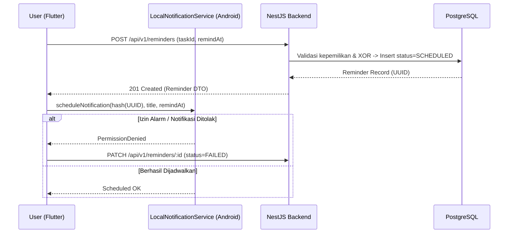

# LifeOS — Kontrak Integrasi, Integritas Data, Keamanan, & Pengujian Rilis

**Dokumen:** `04-architecture-security-testing.md`  
**Produk:** LifeOS (Personal Productivity App · Android)  
**Cakupan:** Bagian 11 s/d 15 Standar Arsitektur & Kesiapan Produksi MVP  

---

## 11. API Contract & Backend Compatibility

- **Verifikasi Endpoint terhadap Implementasi Nyata:** Seluruh konsumsi API di Flutter wajib diverifikasi terhadap implementasi modul NestJS (`backend/src/{auth,tasks,habits,calendar,reminders,dashboard,statistics}`) dan dokumentasi OpenAPI/Swagger (`/api/docs`) sebelum diintegrasikan ke UI.
- **Kontrak Lengkap per Fitur:** Setiap modul fitur wajib mendokumentasikan HTTP method, path `/api/v1/...`, DTO request schema (`class-validator`), DTO response schema, *Bearer token guard*, dan kode error spesifik (`400`, `401`, `403`, `404`, `409`).
- **Larangan Asumsi Kontrak di Klien:** Kode Flutter (`mobile/lib/features/*/data`) tidak boleh mengasumsikan field JSON atau endpoint yang belum diverifikasi di backend.
- **Manajemen Perubahan Kontrak:** Setiap perubahan struktur payload atau parameter query antara backend NestJS dan Flutter harus diperbarui terlebih dahulu di [`03-technical-spec.md`](file:///C:/Users/Rey/Documents/Projects/lifeOS/planning/03-technical-spec.md) dan DTO kedua sisi secara bersamaan.
- **Konsistensi Perhitungan di Server:** Perhitungan angka ringkasan Dashboard (`total`, `completed`, `pending`, `overdue`) dan Statistik (`completionRate`, *habit consistency*, *streak*) dilakukan di server NestJS agar logika bisnis memiliki satu sumber kebenaran tunggal (*Single Source of Truth*).

---

## 12. Data Integrity, Local Caching, & Reminder Synchronization

Sesuai keputusan arsitektur MVP LifeOS, aplikasi menggunakan strategi **Online-First dengan Local Read Cache & Explicit Local Notification Synchronization**:

### 12.1 Strategi Caching Lokal (Online-First Read Cache)
- **Fungsi Cache Lokal:** Menyimpan *snapshot* respons sukses terakhir dari `GET /dashboard/today`, `GET /tasks`, `GET /habits`, dan `GET /calendar/events` di penyimpanan lokal perangkat (SQLite/Drift atau SharedPreferences JSON cache).
- **Perilaku Saat Offline:**
  - Ketika perangkat kehilangan koneksi internet, aplikasi tetap dapat dibuka dan menampilkan data terakhir dari *cache* disertai indikator **`OfflineBanner`**.
  - Aksi mutasi (membuat/mengubah/menghapus tugas, kegiatan, atau *check-in* kebiasaan) membutuhkan konfirmasi server secara langsung (*online-first*) agar tidak terjadi konflik *state* lintas fitur pada MVP.
- **Idempotensi Operasi Tulis & Retry:**
  - Endpoint `PUT /habits/:id/logs/:date` wajib bersifat **idempotent** di level database (`@@unique([habitId, logDate])` melalui mekanisme `upsert` / `deleteMany`), sehingga pengiriman ulang (*retry*) akibat jaringan lambat tidak pernah menghasilkan catatan ganda.

### 12.2 Konsistensi Zona Waktu (Timezone Integrity)
- **Penyimpanan Server:** Seluruh *timestamp* waktu (`dueAt`, `completedAt`, `startsAt`, `endsAt`, `remindAt`, `createdAt`) disimpan di PostgreSQL dalam format `TIMESTAMPTZ(3)` (UTC).
- **Tanggal Kalender Lokal (`HabitLog` & `Dashboard`):**
  - `HabitLog.logDate` disimpan sebagai `@db.Date` (`YYYY-MM-DD`) yang merepresentasikan tanggal kalender menurut zona waktu pengguna (`User.timezone`, default `"Asia/Jakarta"`).
  - Query agregasi harian pada `/dashboard/today?date=YYYY-MM-DD` dan `/statistics/*` wajib menghitung batas awal hari (`00:00:00.000`) dan akhir hari (`23:59:59.999`) menggunakan offset zona waktu pengguna sebelum memfilter kolom `TIMESTAMPTZ` di PostgreSQL.

### 12.3 Sinkronisasi Siklus Hidup Reminder & Notifikasi Lokal Android
Karena backend tidak mengirim *push notification* untuk membangunkan alarm lokal di MVP, sinkronisasi antara tabel `reminders` di PostgreSQL dan `flutter_local_notifications` di Android wajib mengikuti aturan berikut:

1. **Saat Reminder Dibuat (`POST /reminders`):** Simpan di server dengan `status = SCHEDULED`, lalu jadwalkan di Android menggunakan ID integer deterministik dari UUID reminder.
2. **Saat Waktu Diubah atau Dibatalkan (`PATCH` / `DELETE /reminders/:id`):** Batalkan alarm lokal lama terlebih dahulu menggunakan ID yang sama, lalu jadwalkan alarm baru jika masih berstatus `SCHEDULED`.
3. **Saat Tugas Diselesaikan (`DONE`) atau Tugas/Kegiatan Dihapus:** Backend otomatis membatalkan reminder terkait (`status = CANCELLED`), dan Flutter membatalkan alarm lokal yang bersesuaian.
4. **Re-Sync Saat App Startup / Resume:** Setiap kali aplikasi dibuka dan terhubung ke internet, Flutter mengambil daftar `GET /reminders?status=SCHEDULED`:
   - Untuk reminder yang `remindAt <= now()`: perbarui status di backend menjadi `SENT`.
   - Untuk reminder yang `remindAt > now()`: pastikan terdaftar di *pending notification requests* Android (menangani kasus alarm hilang setelah *device reboot* atau *app update*).
5. **Pembersihan Saat Logout:** Ketika pengguna melakukan `logout`, aplikasi wajib:
   - Memanggil `POST /auth/logout` untuk mencabut refresh token di server.
   - Membatalkan seluruh jadwal notifikasi lokal Android (`cancelAll()`).
   - Menghapus seluruh token dari `flutter_secure_storage` dan membersihkan *local read cache*.

---

## 13. Security & Privacy

### 13.1 Kontrol Keamanan Aplikasi & API
- **Penyimpanan Kredensial Aman:** `accessToken` dan `refreshToken` wajib disimpan di `flutter_secure_storage` (dienkripsi dengan Android Keystore `EncryptedSharedPreferences`). Dilarang keras menyimpan token di `SharedPreferences` biasa atau log konsol.
- **Hashing Password & Refresh Token:**
  - Password pengguna di-*hash* menggunakan algoritma **Argon2id** (`argon2` package).
  - Refresh token mentah tidak pernah disimpan di database; hanya nilai *hash* SHA-256 / Argon2-nya yang disimpan di kolom `refresh_tokens.token_hash`.
- **Otorisasi Kepemilikan Resource (Zero IDOR):**
  - Semua endpoint memvalidasi identitas pengguna dari payload JWT (`req.user.sub`) di server.
  - Setiap query baca, ubah, dan hapus pada `Task`, `Habit`, `HabitLog`, `CalendarEvent`, dan `Reminder` wajib menyertakan klausa kepemilikan `userId: currentUser.id`. Pengguna A tidak boleh bisa menebak UUID milik Pengguna B.
- **Validasi Input Ketat (Whitelist DTO):**
  - NestJS wajib mengaktifkan `ValidationPipe({ whitelist: true, forbidNonWhitelisted: true, transform: true })` secara global untuk mencegah *Mass Assignment Vulnerability* (misalnya pengguna menyisipkan `userId` milik orang lain di body JSON).
- **Rate Limiting & Proteksi Brute Force:**
  - Terapkan `@nestjs/throttler` khususnya pada endpoint `/auth/login`, `/auth/register`, dan `/auth/refresh` (misal: maksimal 10 percobaan per menit per IP) untuk mencegah *credential stuffing* dan *brute force*.
- **Keamanan Header & Error Sanitization:**
  - Aktifkan `helmet` di NestJS dan batasi konfigurasi CORS sesuai lingkungan.
  - Global Exception Filter dilarang mengekspos error mentah Prisma (`PrismaClientKnownRequestError` detail skema internal) atau *stack trace* ke response JSON klien.

---

## 14. Testing & Release Acceptance

### 14.1 Strategi Pengujian Berlapis
1. **Backend Unit Tests (Jest):**
   - Menguji logika bisnis murni di Service:
     - Transisi `completedAt` pada Task (`DONE` $\rightarrow$ terisi, dibuka kembali $\rightarrow$ `null`).
     - Algoritma `currentStreak` Habit: hari non-aktif (`!activeDays.includes(weekday)`) tidak memutus *streak*, hari ini belum selesai tidak mereset *streak* kemarin ke `0`, habit baru dibuat hari ini bernilai `0` sebelum check-in dan `1` setelah check-in, serta penolakan log masa depan (`logDate > todayLocal`).
     - Validasi DTO & Service untuk `activeDays`: menolak `[]`, `[0]`, `[8]`, dan duplikat `[1, 1, 3]`.
     - Validasi rentang waktu `CalendarEvent` (`endsAt > startsAt`) dan aturan XOR `Reminder` (`taskId` XOR `eventId`).
     - Konversi tanggal lokal (`user.timezone`) ke interval setengah-terbuka `[startUtc, endUtc)` (`>= startUtc AND < endUtc`) agar batas tengah malam tidak menghitung tugas/event dua kali.
2. **Backend E2E / Integration Tests (Jest + Supertest / Playwright API):**
   - Menguji seluruh siklus hidup endpoint `/api/v1/*` terhadap database PostgreSQL khusus pengujian (termasuk verifikasi constraint SQL).
   - **Kasus Uji Keamanan & Invariant Wajib:**
     - **Cross-Tenant Reminder Ownership:** User A mencoba `POST /reminders` atau `PATCH /reminders/:id` dengan `taskId` atau `eventId` milik User B $\rightarrow$ wajib ditolak (`404 Not Found` di service & dilindungi composite FK di DB).
     - **Case-Insensitive Email:** Registrasi `Rayhan@Example.com` diikuti `rayhan@example.com` $\rightarrow$ ditolak `409 Conflict`, dan login dengan variasi huruf besar/kecil tetap berhasil.
     - **Atomic Refresh Token Reuse Detection:** Menggunakan ulang `refreshToken` lama yang sudah dirotasi (`revokedAt IS NOT NULL`) $\rightarrow$ mengembalikan `401 TOKEN_REUSE_DETECTED` dan mencabut seluruh refresh token aktif milik user tersebut.
     - **Idempotency Habit Check-in:** Mengirim `PUT /habits/:id/logs/2026-10-18` dengan `{ "completed": true }` berulang kali hanya menghasilkan 1 baris di `habit_logs`.
3. **Flutter Unit & Widget Tests (`flutter_test`):**
   - Menguji serialisasi DTO/Model, konversi zona waktu UTC ke lokal, pemetaan deterministik UUID reminder ke `int32` notification ID, state transisi Riverpod Notifier/Provider, serta komponen UI (`TaskCard`, `HabitCard`, `AppEmptyState`, `ErrorState`).
4. **Android End-to-End Tests (Patrol / Flutter Integration Test):**
   - Menguji *critical user journeys* pada emulator/perangkat Android (API 26+): Register $\rightarrow$ Login $\rightarrow$ Buat Tugas $\rightarrow$ Centang Tugas di Dashboard $\rightarrow$ Buat Habit & Check-in $\rightarrow$ Buat Event Kalender $\rightarrow$ Jadwalkan Reminder Lokal (termasuk interaksi dialog izin notifikasi Android) $\rightarrow$ Logout.

### 14.2 Matriks Skenario Uji Wajib Sebelum Rilis
- [x] **Uji Kepemilikan Target Reminder:** Akun B mencoba membuat/mengubah reminder yang menunjuk ke `taskId`/`eventId` milik Akun A $\rightarrow$ ditolak `404` oleh service dan ditolak composite FK oleh PostgreSQL.
- [x] **Uji Validasi `activeDays` Tanpa Duplikat:** Input `[]`, `[0]`, `[8]`, dan `[1, 1, 3]` pada pembuatan/edit habit $\rightarrow$ ditolak `400 VALIDATION_ERROR` di API dan ditolak `CHECK` constraint di DB.
- [x] **Uji Konsistensi `currentStreak`:** Habit dengan jadwal Senin–Rabu–Jumat yang selesai pada Senin & Rabu tetap menampilkan `currentStreak = 2` pada hari Kamis (hari non-aktif) dan pada hari Jumat pagi sebelum di-*check-in*.
- [x] **Uji Siklus Hidup Reminder & Notifikasi Lokal:** Mengubah `remindAt`, menyelesaikan Task (`DONE`), atau menghapus Task/Event otomatis membatalkan jadwal notifikasi lokal lama di Android; membuka ulang aplikasi merekonsiliasi status `SCHEDULED` $\rightarrow$ `SENT` untuk jadwal yang sudah lewat.
- [x] **Uji Batas Tanggal & Zona Waktu `[startUtc, endUtc)`:** Tugas/Event pada pukul `23:59` dan `00:00` waktu lokal (`Asia/Jakarta`) tampil tepat di tanggal lokalnya masing-masing tanpa terhitung ganda.
- [x] **Uji Jaringan Terputus:** Matikan jaringan saat berada di Dashboard $\rightarrow$ aplikasi menampilkan data *cache* dan *OfflineBanner* tanpa *crash*.
- [x] **Uji Kedaluwarsa & Rotasi Refresh Token:** Saat `accessToken` habis masa berlakunya (15 menit), request berikutnya otomatis memicu `/auth/refresh` satu kali; percobaan memakai ulang refresh token lama mencabut seluruh sesi aktif.
- [x] **Uji Penolakan Izin Notifikasi Android 13+:** Tolak izin `POST_NOTIFICATIONS` saat membuat reminder $\rightarrow$ status reminder ditandai `FAILED` dan UI memberi panduan mengaktifkan izin tanpa *unhandled exception*.

---

## 15. Open Decisions & Dependencies (Telah Dikunci untuk Fase 1)

Seluruh keputusan kritis sebelum *migration* pertama telah disepakati dan dikunci:

| ID | Area Keputusan | Ketetapan Final yang Dikunci | Lokasi Penegakan |
| :--- | :--- | :--- | :--- |
| **OD-01** | **Kepemilikan Target Reminder** | `userId` diambil eksklusif dari JWT; Service memverifikasi target `taskId`/`eventId` milik `currentUser.id`; DB menegakkan composite FK `(task_id, user_id)` & `(event_id, user_id)` dengan `@@unique([id, userId])`. | Prisma Schema + SQL Migration + `RemindersService` |
| **OD-02** | **Validasi `activeDays` Unik** | Wajib berisi integer `1..7` tanpa duplikat (`@ArrayUnique()` di DTO + kanonik sort di Service + `array_positions` check di SQL). | `CreateHabitDto` + SQL Migration |
| **OD-03** | **Definisi `currentStreak`** | Dievaluasi dalam `user.timezone`; hanya menghitung `activeDays`; hari non-aktif di-skip; hari ini yang belum selesai tidak memutus *streak* kemarin; log masa depan ditolak (`400`). | `HabitsService` |
| **OD-04** | **Status & Rescheduling Reminder** | `SENT` = perangkat melaporkan alarm telah dipicu/lewat saat izin aktif; `DONE` pada Task membatalkan reminder (`CANCELLED`); rekonsiliasi penuh dijalankan saat *app startup/resume*. | `RemindersService` + Flutter `LocalNotificationService` |
| **OD-05** | **Interval Waktu & Timezone** | Tanggal lokal dikonversi menurut `user.timezone` menjadi interval setengah-terbuka `[startUtc, endUtc)` (`>= startUtc AND < endUtc`); Event menggunakan overlap `startsAt < endUtc AND endsAt > startUtc`. | `DateRangeHelper` (`backend/src/common/`) |
| **OD-06** | **Normalisasi Email & Token Reuse** | Email dinormalisasi `.trim().toLowerCase()` + SQL `CHECK (email = lower(email))`. Reuse refresh token yang sudah `revokedAt IS NOT NULL` mencabut seluruh sesi user secara atomik. | `AuthService` + SQL Migration |

