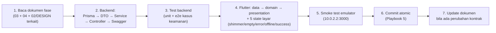

# LifeOS — Alur Implementasi & Prompt Pengerjaan (06)

**Dokumen:** `06-implementation-workflow-and-prompts.md`
**Fungsi:** Menjembatani dokumen perencanaan (01–05 + DESIGN.md) dengan eksekusi nyata. Berisi peta dokumen, status repo, alur fase beserta *gate* verifikasi, dan **prompt siap tempel** untuk AI coding agent per fase.

**Cara pakai:** Satu fase = satu sesi kerja. Tempel prompt fase tersebut, verifikasi gate-nya, commit (Playbook 5 di `05-engineering-playbooks.md`), baru lanjut fase berikutnya.

---

## 1. Peta Dokumen & Ringkasan

| File | Fokus | Peran dalam Eksekusi |
| :--- | :--- | :--- |
| `planning/README.md` | Indeks + roadmap 6 fase + stack | Pintu masuk |
| `planning/01-prd.md` | Problem, persona, 15 user story, daftar fitur MVP/v2, functional requirements lengkap, data model, edge cases, success metrics, 5 keputusan terkunci | **APA & KENAPA** dibangun |
| `planning/02-design-brief.md` | 3 prinsip desain, inventaris 10 layar + route, user flows, layout per layar, component library, 5 state layar, responsif, aksesibilitas | **PERILAKU UX** |
| `planning/03-technical-spec.md` | Skema `schema.prisma` penuh, 5 SQL constraint, aturan integritas, spesifikasi streak, status reminder, aturan timezone `[startUtc, endUtc)`, kontrak REST `/api/v1` per modul, struktur monorepo, `.env` + docker-compose, acceptance criteria, urutan fase | **KONTRAK TEKNIS (single source of truth)** |
| `planning/04-architecture-security-testing.md` | Kompatibilitas kontrak, strategi online-first + read cache, sinkronisasi reminder (sequence diagram), keamanan (Argon2id, JWT rotation, Zero IDOR, Throttler, Helmet), strategi testing 4 lapis, 8 matriks uji rilis, keputusan OD-01..OD-06 | **JAMINAN MUTU & KEAMANAN** |
| `planning/05-engineering-playbooks.md` | 6 playbook operasional dengan prompt: Security Audit, Bug Triage, E2E Testing, Cleanup 2 fase, Atomic Commits, Skill Generator | **SOP OPERASIONAL** |
| `DESIGN.md` (root) | Design system terbaru (lavender `#5B5BF6`): warna light/dark, tipografi Plus Jakarta Sans, radius, navigasi 4 tab + center FAB, spesifikasi 10 layar, state & mikro-interaksi, anti-patterns | **DESAIN VISUAL TERBARU** |
| `design/` | Mockup onboarding (`onboarding_current.png`, `onboarding_revised.png`) + `references/` | Aset visual S-01 |

> ⚠️ **Catatan file rusak:** `design/onboarding_screen.txt` (80 byte) dan `design/onboarding.html` (50 byte) hanya berisi teks error/sampah — bukan konten desain. Disarankan dihapus.

---

## 2. Status Repo Saat Ini (titik awal)

| Area | Status | Detail |
| :--- | :--- | :--- |
| `backend/` | ❌ **Belum ada** | Seluruh Fase 1 backend dimulai dari nol |
| Git | ❌ Belum `git init` | Perlu diinisialisasi di Fase 1 |
| `mobile/` scaffold | ✅ Selesai | Flutter project + Android + dependency lengkap di `pubspec.yaml` (Riverpod, GoRouter, Dio, secure storage, local notifications, table_calendar, fl_chart, shimmer, lucide, google_fonts) |
| `mobile/lib/app/theme.dart` | ✅ Selesai | Tokens DESIGN.md lengkap (light + dark) |
| `mobile/lib/app/router.dart` | 🚧 Placeholder | Route constants 4 tab + FAB sudah didefinisikan; hanya `/dashboard` placeholder yang terdaftar |
| `mobile/lib/core/` | ✅ Selesai | `api_client.dart` (Dio + AuthInterceptor single-flight refresh 401), `secure_storage_service.dart`, `local_cache_service.dart`, `local_notification_service.dart` (ID deterministik 31-bit, schedule/cancel, tz), `api_exception.dart` (mapping format error NestJS) |
| `mobile/lib/features/` | ❌ Belum ada | Semua modul fitur (auth, tasks, habits, calendar, reminders, dashboard, statistics) akan dibuat per fase |

**Kesimpulan:** fondasi klien sudah matang; pekerjaan tersisa = membangun `backend/` (Fase 1–6) sambil mengisi `features/` di Flutter per fase.

---

## 3. Keputusan yang Perlu Dikonfirmasi Sebelum Fase 1

| No | Konflik / Ambiguitas | Rekomendasi |
| :--- | :--- | :--- |
| 1 | **Token warna:** `02-design-brief.md` memakai Indigo `#4F46E5` + slate; `DESIGN.md` memakai lavender `#5B5BF6` + soft lavender | **DESIGN.md menang** untuk visual (sudah diimplementasi di `theme.dart`). `02-design-brief.md` tetap dipakai untuk flow/state/aksesibilitas |
| 2 | **Navigasi:** `02-design-brief.md` = 5 tab (Statistics jadi tab); `DESIGN.md` = 4 tab + center FAB, Statistics dari avatar header | **Ikut DESIGN.md** (konsisten dengan `router.dart` saat ini) |
| 3 | **Bahasa UI:** `DESIGN.md` contoh string Inggris ("Good Morning", "My Tasks"); `01/02` berbahasa Indonesia | Ikut `DESIGN.md` (Inggris) untuk label yang sudah dicontohkan; sisanya Bahasa Indonesia ringkas. Bisa diubah kapan saja |
| 4 | File rusak `design/onboarding_screen.txt` & `design/onboarding.html` | Hapus (artefak error, bukan konten) |

---

## 4. Alur Besar (Roadmap Eksekusi)

```mermaid
flowchart TD
    F1["Fase 1 · Fondasi\nMonorepo + git + Docker PG17 + NestJS + Prisma 6\n+ 5 SQL constraint + Swagger + Error Filter"]
    G1{"Gate 1\nmigrate reset bersih · /api/docs hidup\nformat error standar terbukti"}
    F2["Fase 2 · Autentikasi\nArgon2id + JWT 15m + Refresh Rotation + reuse detection\n+ Flutter: Onboarding, Login, Register, Splash Gate"]
    G2{"Gate 2\nreuse detection 401 + revoke all lulus\nsesi persisten di emulator"}
    F3["Fase 3 · Task Management\nCRUD + filter + search + pagination\n+ completedAt lifecycle + cancel reminder on DONE"]
    G3{"Gate 3\nCRUD penuh UI→PostgreSQL\n404 lintas user · lifecycle lulus"}
    F4["Fase 4 · Habit Tracker\nactiveDays + idempotent check-in + streak §3.1\n+ weekly grid & heatmap"]
    G4{"Gate 4\nmatriks streak §14.1 lulus\nPUT 3x = 1 baris log"}
    F5["Fase 5 · Dashboard & Kalender\nagregasi FR-DASH + agenda gabungan EVENT/TASK\n+ online-first read cache + OfflineBanner"]
    G5{"Gate 5\nangka dashboard = SQL manual\nbatas 23:59/00:00 aman · offline aman"}
    F6["Fase 6 · Reminder & Statistik\nlocal notification Android + rekonsiliasi reboot\n+ statistics overview/weekly + layar S-10"]
    G6{"Gate 6\nmatriks reminder §14.2 lulus\nnotif lokal jalan & reboot reschedule\nstatistik = DB"}
    F7["Fase 7 · Hardening & Release Gate\nE2E (Playbook 3) + Security Audit (Playbook 1)\n+ Cleanup (Playbook 4) + checklist §7/§14.2"]
    R["🚀 Release MVP"]

    F1 --> G1 --> F2 --> G2 --> F3 --> G3 --> F4 --> G4 --> F5 --> G5 --> F6 --> G6 --> F7 --> R
```



---

## 5. Siklus Kerja Standar per Fase



### 🔒 Aturan Emas (berlaku di semua fase)

1. **Satu fase = satu sesi.** Jangan melompat fase sebelum gate lulus.
2. **Kontrak REST di `03-technical-spec.md` adalah undang-undang.** Perubahan kontrak apa pun wajib memperbarui dokumen tersebut + DTO kedua sisi dalam satu perubahan yang sama.
3. **`userId` SELALU dari JWT.** Resource milik user lain → `404` (anti IDOR). Dilarang membaca `userId` dari request body.
4. **Waktu:** DB menyimpan UTC (`Timestamptz(3)`); tanggal kalender lokal dihitung via `user.timezone`; semua filter rentang memakai interval setengah-terbuka `[startUtc, endUtc)` dengan **satu helper tunggal** di `backend/src/common/`.
5. **UI:** `DESIGN.md` = patokan visual; `02-design-brief.md` = perilaku/flow/state/a11y; setiap layar wajib menangani 5 state; aksi cepat = optimistic + haptic.
6. **Setiap akhir fase:** test hijau, `flutter analyze` bersih, `prisma migrate reset` bersih, laporan gate ke user, lalu commit atomic.

---

## 6. Prompt Siap Pakai

### 6.1 Prompt Fase 1 — Fondasi Backend & Monorepo

```text
Berperan sebagai backend engineer senior. Mulai FASE 1 (Fondasi) LifeOS di repo monorepo ini
(Windows, working dir: C:\Users\Rey\Documents\Projects\lifeOS).

KONTEKS — WAJIB DIBACA DULU sebelum menulis kode:
- planning/03-technical-spec.md §3 (skema Prisma + 5 SQL constraint), §4 (format error standar),
  §5 (struktur monorepo), §6 (.env + docker-compose + urutan init), §7 (acceptance).
- planning/04-architecture-security-testing.md §13 (whitelist DTO, helmet, CORS, rate limit,
  error sanitization) dan §3 relasi inti.
- planning/README.md untuk gambaran umum.

TUGAS:
1. git init di root + .gitignore monorepo (node_modules/, dist/, build/, .dart_tool/, .env, dsb.)
   + README.md root ringkas (cara menjalankan backend & mobile).
2. Buat docker-compose.yml PERSIS planning/03 §6 (postgres:17, healthcheck, volume).
3. Scaffold NestJS di backend/ (npx @nestjs/cli new backend --package-manager npm --skip-git),
   install dependency persis daftar §6, tambahkan @nestjs/throttler + helmet.
4. Tulis backend/prisma/schema.prisma PERSIS skema §3: semua model (User, Task, Habit, HabitLog,
   CalendarEvent, Reminder, RefreshToken), semua enum, @@unique([id, userId]) pada tasks &
   calendar_events, semua index.
5. Jalankan npx prisma migrate dev --name init, lalu tempel 5 blok custom SQL constraint dari §3
   (email lowercase, endsAt > startsAt, XOR reminder, composite FK owner task/event,
   active_days range+unique) ke file migration.sql, dan buktikan dengan `npx prisma migrate reset`
   berulang hingga bersih.
6. backend/src/main.ts: prefix global /api/v1, ValidationPipe({whitelist:true,
   forbidNonWhitelisted:true, transform:true}), Global Exception Filter sesuai format §4
   (statusCode/code/message/details — TANPA stack trace Prisma), helmet, CORS dev, Swagger /api/docs.
7. Siapkan struktur folder backend/src sesuai §5 (auth/, users/, tasks/, habits/, calendar/,
   reminders/, dashboard/, statistics/, prisma/, common/{decorators,filters,guards,pipes}) —
   modul boleh kosong, isi di fase masing-masing.
8. backend/.env.example persis §6 + backend/.env lokal yang valid.

VERIFIKASI (jalankan dan tunjukkan hasilnya):
- docker compose up -d → pg_isready sehat.
- npx prisma migrate reset → sukses tanpa error (migration reproducible dari nol).
- npm run build → hijau; npm run start:dev → GET /api/docs tampil di browser.
- Kirim 1 request invalid ke route contoh → format error standar §4 keluar (bukan error NestJS default).

LARANGAN: jangan mulai modul auth/tasks dsb. Jangan sentuh mobile/. Jangan commit dulu.
Laporkan: daftar file dibuat, hasil verifikasi, lalu BERHENTI dan tunggu instruksi.
```

---

### 6.2 Prompt Fase 2 — Autentikasi (Backend + Flutter Auth & Onboarding)

```text
Berperan sebagai full-stack engineer. Kerjakan FASE 2 — Autentikasi. Fase 1 diasumsikan sudah lulus gate.

KONTEKS — WAJIB DIBACA DULU:
- planning/03-technical-spec.md §4.1 (endpoint & DTO auth + contoh response), §3 aturan integritas
  no.5 & no.6 (email lowercase, hash refresh token, rotasi atomik + reuse detection), §3.2 tidak
  berlaku di fase ini.
- planning/04-architecture-security-testing.md §12.3 poin 5 (pembersihan saat logout) dan §13
  (Argon2id, secure storage, throttler, zero IDOR), §14.1 (kasus uji token reuse).
- planning/02-design-brief.md §4 (S-01/S-02/S-03) + DESIGN.md §6 (S-01/S-02/S-03) +
  design/onboarding_current.png sebagai referensi visual onboarding.

BACKEND (backend/src/auth + users) — ikuti §4.1 persis:
1. register: normalisasi email .trim().toLowerCase(), hash Argon2id, kembalikan user + tokens.
2. login: verifikasi Argon2; refresh: ROTASI token di dalam prisma.$transaction
   (revoke lama + terbitkan baru).
3. REUSE DETECTION: refresh token dengan revokedAt != null dipakai lagi → cabut SEMUA refresh
   token aktif milik user itu secara atomik + 401 TOKEN_REUSE_DETECTED.
4. Refresh token: string acak ≥64 byte (crypto), yang disimpan hanya SHA-256 hash +
   expiresAt (30 hari dari REFRESH_TOKEN_TTL_DAYS). Token mentah hanya di response body.
5. Access JWT 15m dari JWT_ACCESS_SECRET/TTL; JwtAuthGuard global + @Public() decorator;
   GET /auth/me mengambil user dari JWT.
6. @nestjs/throttler khusus /auth/login, /auth/register, /auth/refresh (10/menit/IP).
7. DTO per §4.1: name 1..100, email format + max 254 + transform, password 8..128,
   timezone IANA valid via Intl.supportedValuesOf('timeZone') (default Asia/Jakarta).
8. Swagger lengkap 5 endpoint.

FLUTTER (mobile/lib/features/auth + update app/router.dart):
9. Struktur data/domain/presentation: AuthRemoteDataSource (pakai dioProvider yang sudah ada),
   AuthRepository, AuthController (Riverpod), model User + AuthSession.
10. Layar: Splash/Auth Gate (baca token dari SecureStorageService → redirect login/dashboard),
    Onboarding S-01 (tampil sekali; flag di SharedPreferences, visual sesuai design), Login S-02,
    Register S-03 dengan chip timezone otomatis via flutter_timezone.
11. Router: redirect berbasis auth state; tab lain tetap placeholder.
12. Error handling: map ApiException.details ke pesan per-field; pesan manusiawi (bukan raw).
13. Sediakan method logout yang lengkap sekarang: POST /auth/logout → clearTokens() →
    LocalNotificationService.cancelAll() → LocalCacheService.clearAllCache().

VERIFIKASI (wajib dibuktikan, tampilkan hasilnya):
- E2E/curl: register → login → GET /auth/me → refresh (dapat pasangan baru) → pakai refresh LAMA
  lagi → 401 TOKEN_REUSE_DETECTED + semua sesi user tercabut di DB.
- Registrasi "Rayhan@Example.com" lalu "rayhan@example.com" → 409.
- Unit test backend: normalisasi email + rotasi/reuse detection.
- flutter analyze bersih + widget test form login (mock secure storage).
- Smoke emulator: register → login → tutup app → buka lagi (sesi persist) → logout
  (token, cache, notifikasi bersih).

LARANGAN: jangan sentuh modul tasks/habits/dll; jangan ubah kontrak tanpa memperbarui
03-technical-spec.md dulu; jangan commit dulu. Laporkan & BERHENTI saat verifikasi lulus.
```

---

### 6.3 Prompt Fase 3 — Task Management

```text
Berperan sebagai full-stack engineer. Kerjakan FASE 3 — Task Management.

KONTEKS — WAJIB DIBACA DULU:
- planning/03-technical-spec.md §4.2 (endpoint, query params, default sorting), §3.3 (aturan
  interval tanggal [startUtc, endUtc)).
- planning/01-prd.md FR-TASK-01..04 (§6.2) + US-06..08 + §10 keputusan no.1 (tugas tanpa dueAt).
- planning/02-design-brief.md §6 (S-05/S-06) + §7 (TaskCard, PriorityBadge, AppEmptyState) +
  DESIGN.md §6 (S-05/S-06).

BACKEND (tasks module):
1. CRUD persis §4.2: POST/GET list/GET detail/PATCH/DELETE (DELETE → 200 {id, deleted:true});
   envelope single {data} & paginated {data, meta}.
2. Filter: status, priority, from/to (berdasarkan dueAt, pakai helper interval §3.3 di common/),
   search ILIKE case-insensitive pada title+description, page/limit (default 1/20, max 100).
3. Default sorting tugas belum selesai: dueAt ASC NULLS LAST → priority DESC → createdAt DESC.
4. Lifecycle completedAt dalam transaksi: → DONE isi NOW(); DONE → TODO/IN_PROGRESS kosongkan null.
5. FR-TASK-04: saat task DONE atau DELETE, semua Reminder SCHEDULED milik task itu →
   CANCELLED (tabel reminders sudah ada dari Fase 1).
6. Zero IDOR: semua query ber-scope userId dari JWT; resource milik user lain → 404.
7. GET /tasks/:id menyertakan daftar reminders terkait.

FLUTTER (features/tasks + core/widgets):
8. Model/DataSource/Repository/Controller Riverpod; list paginated + optimistic toggle status.
9. Widget core: TaskCard (compact Dashboard / detailed list; state todo, inProgress, done
   strikethrough opasitas 0.65, overdue dengan label "Terlambat" + ikon), PriorityBadge, AppEmptyState.
10. Layar S-05: search debounce 400ms, filter chips, infinite scroll, pull-to-refresh,
    skeleton shimmer, OfflineBanner, error state + "Coba Lagi".
11. Task Detail Sheet S-06: edit semua field + hapus dengan konfirmasi; toggle "Remind me"
    tampil sebagai placeholder (fungsional di Fase 6).
12. Quick Add bottom sheet dari center FAB: tab "Task" aktif; tab Event & Habit disabled sementara.
13. Accessibility: Semantics checkbox 'Tandai tugas [judul] selesai' + HapticFeedback.lightImpact().

VERIFIKASI:
- E2E: buat → filter 3 kombinasi → search → DONE (completedAt terisi) → reopen (null) → delete;
  akses UUID milik user lain → 404.
- Unit test service: lifecycle completedAt + urutan default sorting.
- flutter analyze bersih + widget test TaskCard (4 state) + smoke emulator alur penuh.

LARANGAN: jangan ubah kontrak; jangan kerja reminder scheduling (Fase 6); jangan commit dulu.
Laporkan & BERHENTI.
```

---

### 6.4 Prompt Fase 4 — Habit Tracker

```text
Berperan sebagai full-stack engineer. Kerjakan FASE 4 — Habit Tracker.

KONTEKS — WAJIB DIBACA DULU:
- planning/03-technical-spec.md §4.3 (endpoint habits/logs) + §3.1 (spesifikasi presisi
  currentStreak — ikuti HARFIAH) + §3 aturan integritas no.2 (activeDays) & no.7 (log masa depan).
- planning/04-architecture-security-testing.md §14.1 (kasus uji streak & activeDays) + §14.2.
- planning/02-design-brief.md §6 (S-08/S-09) + DESIGN.md §6 (S-08/S-09).

BACKEND (habits module):
1. CRUD habits. Validasi activeDays: DTO @IsArray/@ArrayMinSize(1)/@ArrayMaxSize(7)/@ArrayUnique/
   @IsInt({each})/@Min(1,{each})/@Max(7,{each}); Service menyimpan hasil kanonik
   [...new Set(days)].sort((a,b)=>a-b).
2. PUT /habits/:id/logs/:date (YYYY-MM-DD) IDEMPOTENT: completed=true → upsert pada unique
   (habitId, logDate) + isi completedAt bila belum ada; completed=false → deleteMany (tanpa baris yatim).
3. Tolak logDate > todayLocal menurut user.timezone → 400 FUTURE_HABIT_LOG_NOT_ALLOWED
   (backfill maksimal H-7 boleh; konfirmasi aturan backfill dari 01-prd §10 no.2).
4. GET /habits menyertakan currentStreak + completedToday + weeklyLogs (minggu berjalan per
   activeDays). GET /habits/:id/logs?from&to urut logDate DESC.
5. Algoritma currentStreak PERSIS §3.1: hanya hitung activeDays; hari non-aktif di-skip (tidak
   memutus); hari ini belum check-in TIDAK memutus streak kemarin; habit baru = 0 → 1 setelah check-in.
6. Unit test matriks: (a) Sen–Rab–Jum, check Sen+Rab → Kamis = 2; (b) Jumat pagi sebelum check-in
   tetap 2; (c) habit baru 0 → 1; (d) log masa depan ditolak; (e) [] / [0] / [8] / [1,1,3] ditolak 400.

FLUTTER (features/habits):
7. Layar S-08: kartu habit dengan pastel icon tile, pill "🔥 N day streak" + "x/y this week",
   progress bar berwarna, tombol check-in bulat 48dp dengan animasi centang ≤200ms + haptic +
   optimistic update; weekly mini-grid 7 lingkaran (hijau=selesai, outlined=hari aktif belum,
   pudar=libur); hero banner sesuai DESIGN.md.
8. Layar S-09 Habit Detail: heatmap bulan berjalan, chip statistik Current streak (dari API) +
   Best streak & Consistency % (hitung client-side dari GET logs — JANGAN ubah kontrak API),
   editor activeDays via chips, riwayat log.
9. Semantics aksesibilitas pada tombol check-in & grid.

VERIFIKASI:
- E2E idempotensi: PUT {completed:true} 3x → tetap 1 baris habit_logs.
- Seluruh matriks streak §14.1 hijau.
- Smoke emulator: check-in dari kartu, streak bertambah, edit activeDays tanpa menghapus histori.

LARANGAN: jangan ubah kontrak; jangan sentuh statistics (Fase 6); jangan commit dulu.
Laporkan & BERHENTI.
```

---

### 6.5 Prompt Fase 5 — Dashboard & Kalender

```text
Berperan sebagai full-stack engineer. Kerjakan FASE 5 — Dashboard & Kalender.

KONTEKS — WAJIB DIBACA DULU:
- planning/01-prd.md FR-DASH-01..03 (§6.6) + US-04/05/11/12 + §10 no.1 & no.4.
- planning/03-technical-spec.md §4.4 (calendar), §4.6 (dashboard), §3.3 (interval & timezone).
- planning/04-architecture-security-testing.md §12.1 (read cache online-first) & §12.2.
- planning/02-design-brief.md §6 (S-04/S-07) + DESIGN.md §6 (S-04/S-07).

BACKEND:
1. Gunakan DateRangeHelper dari common/ (dibuat di Fase 3) — JANGAN duplikasi logika timezone.
2. GET /dashboard/today?date= : hitung batas hari dari user.timezone; metrik PERSIS FR-DASH-02
   (tasks: total/completed/pending/overdue) & FR-DASH-03 (habits: scheduled/completed);
   sertakan upcomingEvents (event hari itu), todayTasks (maks 5 + backlog tanpa dueAt sesuai
   §10 no.1), todayHabits. Bentuk response §4.6.
3. Calendar module: CRUD events (validasi endsAt > startsAt → 400 INVALID_TIME_RANGE);
   GET /calendar/events?from&to → events beririsan (startsAt < endUtc AND endsAt > startUtc)
   + tasks (dueAt dalam rentang), masing-masing dengan diskriminator type EVENT/TASK,
   urut kronologis (events: startsAt ASC; tasks: dueAt ASC).

FLUTTER:
4. Dashboard S-04 sesuai DESIGN.md: header sapaan dinamis + tanggal lokal + bell (→ daftar
   reminder) + avatar (→ Statistics), Daily Progress ring card, 2x2 stat grid, Quick Actions,
   Today's Agenda (kartu horizontal aksen violet), Habit hari ini (check-in 1 tap),
   Today's Tasks (checkbox 1 tap) + See All.
5. Read cache: setiap GET sukses (dashboard/tasks/habits/calendar) tulis snapshot ke
   LocalCacheService; saat DioException network → tampilkan snapshot + OfflineBanner
   ("Mode Offline · Menampilkan data terakhir"); mutasi saat offline → Snackbar jelas.
6. Calendar S-07: table_calendar mode bulan + strip minggu (toggle), dot marker (event violet,
   tenggat task amber / merah overdue), timeline agenda tanggal terpilih (kartu aksen kiri,
   urut kronologis), tombol "Hari Ini", FAB "+ Add Event" → bottom sheet dengan validasi
   endsAt > startsAt juga di klien.
7. Helper konversi UTC → lokal TUNGGAL (dipakai dashboard, calendar, tasks) — jangan tersebar.
8. Semua layar: skeleton shimmer, empty state kontekstual, error + "Coba Lagi".

VERIFIKASI:
- Seed data contoh → angka /dashboard/today dibandingkan dengan query SQL manual → harus identik.
- Uji batas: tugas/event 23:59 dan 00:00 waktu Asia/Jakarta tampil tepat di tanggal lokalnya,
  tidak dobel (matriks 04 §14.2).
- Mode pesawat: dashboard & kalender menampilkan cache + banner tanpa crash.
- Unit test Flutter: konversi timezone & model calendar.

LARANGAN: jangan ubah kontrak; jangan sentuh statistics (Fase 6); jangan commit dulu.
Laporkan & BERHENTI.
```

---

### 6.6 Prompt Fase 6 — Reminder & Statistik

```text
Berperan sebagai full-stack engineer. Kerjakan FASE 6 — Reminder & Statistik (fase fitur terakhir).

KONTEKS — WAJIB DIBACA DULU:
- planning/03-technical-spec.md §3.2 (semantik status + matriks mutasi/rescheduling — ikuti
  HARFIAH), §4.5 (reminders), §4.6 (statistics).
- planning/04-architecture-security-testing.md §12.3 (sequence diagram + 5 poin sinkronisasi)
  dan §14.2 (matriks uji rilis).
- planning/01-prd.md FR-REM-01..04 (§6.5) + FR-STAT-01..02 + edge cases §8 no.1 & no.2.
- DESIGN.md §6 S-10 (Statistics & Profile).

BACKEND (reminders + statistics):
1. Reminders CRUD persis §4.5: XOR taskId/eventId (400 REMINDER_TARGET_XOR_VIOLATION);
   verifikasi kepemilikan target → 404 bila bukan milik user; remindAt > NOW() untuk SCHEDULED;
   PATCH remindAt ke masa depan → otomatis SCHEDULED; GET ?status=SCHEDULED urut remindAt ASC.
2. Statistics overview: total/completed/overdue/completionRate (1 desimal);
   habit consistency = completed instances / scheduled instances (scheduled dihitung dari
   activeDays × hari dalam rentang). Weekly: 7 hari tasksCompleted/habitsScheduled/habitsCompleted.
3. Unit/e2e: XOR violation, cross-tenant reminder 404 (+ buktikan composite FK menolak di SQL),
   rate limit login.

FLUTTER (features/reminders + statistics):
4. Flow simpan Task/Event dengan toggle "Ingatkan saya": requestNotifikasi/permission dulu →
   POST /reminders → LocalNotificationService.scheduleReminder() (sudah ada).
   Izin ditolak → PATCH {status: FAILED} + banner arahkan ke Pengaturan Android (edge case §8 no.1).
5. Siklus hidup sesuai matriks §3.2: ubah remindAt → cancel + reschedule; task DONE → cancel
   semua notif task itu; delete task/event → cancel; semua pakai ID deterministik yang sama.
6. Rekonsiliasi startup/resume: GET reminders?status=SCHEDULED vs pendingNotificationRequests()
   → cancel orphan, PATCH SENT (lewat waktu & izin aktif) / FAILED (izin mati), reschedule yang
   hilang pasca reboot (edge case §8 no.2).
7. Android: izin POST_NOTIFICATIONS + SCHEDULE_EXACT_ALARM + RECEIVE_BOOT_COMPLETED + receiver
   sesuai README flutter_local_notifications; uji reboot emulator.
8. Layar S-10 Statistics & Profile: header navy + stats row, pill tab Overview/Tasks/Habits,
   KPI cards, bar chart mingguan (fl_chart), menu list (Reminders + badge count, Notifications,
   Appearance, Timezone, Help), tombol Logout (konfirmasi → revoke + bersih-bersih penuh).
9. Halaman daftar Reminder terjadwal: status badge, edit waktu, cancel.

VERIFIKASI (buktikan item §14.2 yang relevan):
- Siklus reminder penuh: buat → ubah waktu → DONE task → semua CANCELLED & notif lokal batal.
- Notifikasi muncul saat app tertutup; reboot emulator → reminder dijadwalkan ulang saat app dibuka.
- Tolak izin notifikasi → status FAILED tanpa crash + UI panduan.
- Angka statistics dibandingkan query SQL manual → identik.

LARANGAN: jangan ubah kontrak; jangan commit dulu. Laporkan & BERHENTI.
```

---

### 6.7 Prompt Fase 7 — Hardening & Release Gate

```text
Kerjakan FASE 7 — Hardening & Release Gate LifeOS (fase penutup).

1. Jalankan Playbook 3 (E2E Testing) dari planning/05-engineering-playbooks.md: susun suite
   journey A–F, minta saya approve daftar journey DULU, lalu jalankan dan perbaiki temuan.
2. Jalankan Playbook 1 (Security Audit pra-rilis): laporkan temuan ber-severity, JANGAN ubah
   kode sebelum saya approve.
3. Setelah fix audit lulus → jalankan Playbook 4 (Cleanup 2 fase) untuk merapikan repo.
4. Verifikasi checklist 03-technical-spec.md §7 (semua item) + seluruh matriks
   04-architecture-security-testing.md §14.2; ukur P95 GET /dashboard/today & GET /tasks < 200ms lokal.
5. Buktikan `prisma migrate reset` bersih di database kosong + tulis README cara menjalankan
   monorepo (backend, mobile, koneksi emulator 10.0.2.2:3000, device fisik via IP LAN).
6. Susun commit terakhir dengan Playbook 5; update planning/ bila ada kontrak yang berubah
   selama fase berjalan.
```

---

### 6.8 Prompt Mini — Melanjutkan Sesi yang Terputus

```text
Lanjutkan proyek LifeOS dari kondisi repo saat ini.
1. Baca planning/06-implementation-workflow-and-prompts.md (§2 status & §6 prompt fase) dan
   tentukan fase mana yang sedang aktif berdasarkan kondisi kode aktual.
2. Periksa gate fase tersebut: mana yang sudah lulus, mana yang belum.
3. Kerjakan HANYA langkah berikutnya yang belum selesai dari fase itu — jangan melompat fase,
   jangan refactor hal di luar lingkupnya.
4. Laporkan progres gate dan tunggu instruksi.
```

---

## 7. Prompt Operasional Harian (Rujuk `05-engineering-playbooks.md`)

| Situasi | Playbook | Kapan dijalankan |
| :--- | :--- | :--- |
| Selesai satu fitur / sebelum commit | **Playbook 5** — Atomic Conventional Git Commits | Setiap akhir langkah kerja |
| Ada bug di Flutter/NestJS | **Playbook 2** — Structured Bug Triage | Saat menemukan bug, sebelum fix |
| Sebelum rilis / akhir fase besar | **Playbook 1** — Security Audit + **Playbook 3** — E2E | Fase 7, atau sebelum push ke staging |
| Selesai satu milestone (mis. Fase 3) | **Playbook 4** — Two-Phase Cleanup | Setelah gate fase lulus |
| Alur berulang muncul lagi | **Playbook 6** — Reusable Skill Generator | Saat ada pola kerja yang ingin dibakukan |

---

## 8. Checklist Release Gate MVP (dari `03` §7 & `04` §14.2)

- [x] Register, login, refresh otomatis, logout berjalan end-to-end
- [x] CRUD tugas + filter + search + lifecycle `completedAt`
- [x] Habit: activeDays, check-in idempotent, streak, riwayat
- [x] Kalender menampilkan event + task sesuai tanggal & zona waktu user
- [x] Reminder: buat/ubah/batal + notifikasi lokal Android + rekonsiliasi reboot
- [x] Dashboard & statistik = data database sebenarnya
- [x] Zero cross-user data leakage (uji 404/403)
- [x] Loading shimmer, empty, error, offline state tersedia di Flutter
- [x] `prisma migrate deploy` / `migrate reset` reproducible di lingkungan baru
- [x] Unit + integration test mencakup logika penting & kontrol akses
- [x] P95 `GET /dashboard/today` & `GET /tasks` < 200ms (lokal/staging)
