# LifeOS — Planning & Architecture Documentation Index

Selamat datang di pusat dokumentasi perencanaan **LifeOS** (*Personal Productivity App · Android*).  
Seluruh dokumen di dalam folder `planning/` ini menjadi acuan tunggal (*Single Source of Truth*) untuk pengembangan produk, desain UI/UX, skema database, kontrak REST API, keamanan, dan pengujian MVP.

---

## Daftar Dokumen Perencanaan

| Urutan | File Dokumen | Fokus & Isi Utama |
| :--- | :--- | :--- |
| **01** | [`01-prd.md`](file:///C:/Users/Rey/Documents/Projects/lifeOS/planning/01-prd.md) | **Product Requirements Document (PRD):** Problem statement, target user & 2 persona mahasiswa, goals & non-goals, 15 user stories, pembagian fitur MVP/v2/Nanti, functional requirements detail per modul, sketsa data model, edge cases, success metrics, dan keputusan terbuka. |
| **02** | [`02-design-brief.md`](file:///C:/Users/Rey/Documents/Projects/lifeOS/planning/02-design-brief.md) | **Product Design Brief & UI/UX:** 3 prinsip desain wajib, arah visual & anti-patterns, design tokens lengkap (Light/Dark hex, tipografi Material 3, spacing, radius), inventaris 10 layar, user flows, detail layout per layar, component library, 5 screen states, responsivitas, dan aksesibilitas. |
| **03** | [`03-technical-spec.md`](file:///C:/Users/Rey/Documents/Projects/lifeOS/planning/03-technical-spec.md) | **Spesifikasi Teknis MVP (Bagian 1–8):** Ruang lingkup teknis, kontrak desain, skema lengkap `backend/prisma/schema.prisma` (Prisma 6 + PostgreSQL 17) beserta SQL `CHECK` constraints, kontrak REST API `/api/v1`, struktur monorepo `lifeos/`, konfigurasi Docker & `.env`, kriteria penerimaan MVP, dan urutan implementasi. |
| **04** | [`04-architecture-security-testing.md`](file:///C:/Users/Rey/Documents/Projects/lifeOS/planning/04-architecture-security-testing.md) | **Integritas Data, Keamanan & Pengujian (Bagian 11–15):** Kompatibilitas kontrak API, strategi *online-first* dengan *local read cache*, sinkronisasi siklus hidup *Reminder* & notifikasi lokal Android, standar keamanan (Argon2, JWT rotation, Zero IDOR), strategi pengujian berlapis, dan matriks kesiapan rilis. |
| **05** | [`05-engineering-playbooks.md`](file:///C:/Users/Rey/Documents/Projects/lifeOS/planning/05-engineering-playbooks.md) | **Engineering & AI Operational Playbooks:** 6 protokol operasional siap pakai untuk *Pre-Launch Security Audit*, *Structured Bug Triage*, *E2E Testing Setup*, *Two-Phase Codebase Cleanup*, *Atomic Conventional Git Commits*, dan *Reusable Skill Generator*. |
| **06** | [`06-implementation-workflow-and-prompts.md`](file:///C:/Users/Rey/Documents/Projects/lifeOS/planning/06-implementation-workflow-and-prompts.md) | **Alur Implementasi & Prompt:** peta dokumen, status repo, roadmap 7 fase + gate verifikasi, prompt siap tempel per fase, checklist Release Gate MVP, dan status Milestone R. |

---

## Ringkasan Roadmap Implementasi (7 Fase + Release)

```mermaid
flowchart LR
    P1["1. Fondasi\n(Monorepo, Docker PG17,\nNestJS, Prisma 6)"] --> P2["2. Autentikasi\n(Register, Login, JWT,\nRefresh Rotation)"]
    P2 --> P3["3. Task Management\n(CRUD, Filter, Search,\ncompletedAt Lifecycle)"]
    P3 --> P4["4. Habit Tracker\n(ActiveDays, Idempotent\nCheck-in, Streak)"]
    P4 --> P5["5. Dashboard & Kalender\n(Agregasi Harian &\nAgenda Terpadu)"]
    P5 --> P6["6. Reminder & Statistik\n(Android Local Notif,\nWeekly Trend, E2E Test)"]
    P6 --> P7["7. Hardening &\nRelease Gate MVP"]
    P7 --> R["🚀 Milestone R\nRelease MVP"]
```

---

## Ringkasan Stack Teknologi

- **Mobile Client:** Flutter (Material 3, Riverpod, GoRouter, Dio, `flutter_secure_storage`, `flutter_local_notifications`)
- **Backend API:** NestJS (TypeScript, REST `/api/v1`, Swagger OpenAPI, `class-validator`, `passport-jwt`, `argon2`)
- **Database & ORM:** PostgreSQL 17 (Docker Compose) + Prisma ORM 6.x
